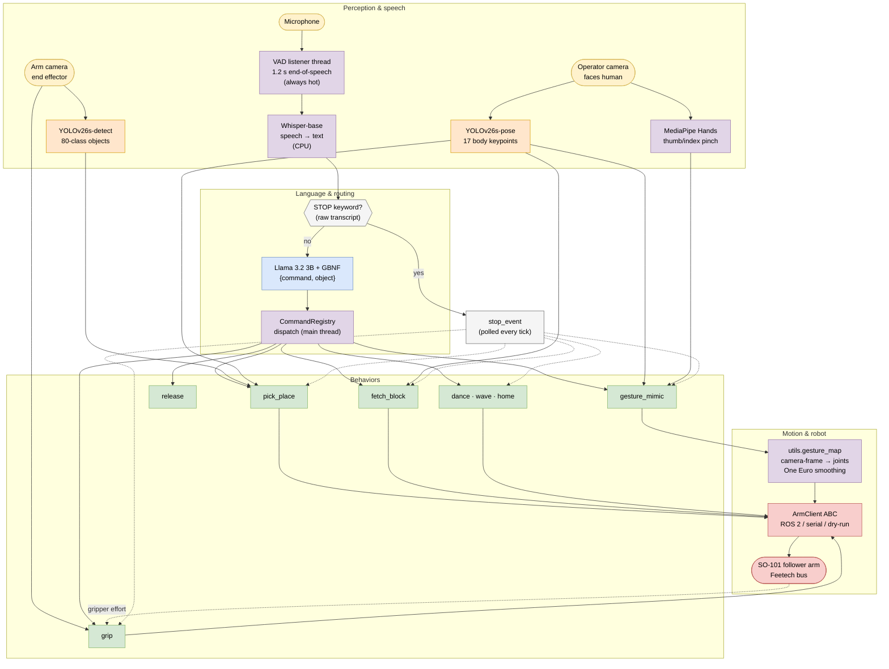
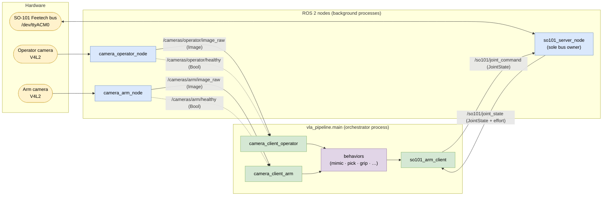

# Strix VVLA Pipeline
Voice-Vision-Language-Action
Whisper-Yolov26-Llama3.2-ROS2

Voice-controlled robot behaviors for the **LeRobot SO-101** arm on an **AMD Ryzen AI APU (Strix Point / Strix Halo, gfx1150 / gfx1151 / gfx1100 for compatibility)** — speech, language, and vision all running locally, split across the NPU, iGPU, and CPU.

The robot has senses: **Whisper is its ears**, **YOLO is its eyes**, **Llama is its brain**, and the **feedback gripper is its sense of touch**. You speak; it hears, understands, looks, and acts.


## Pipeline architecture



Legend — <span title="NPU">🟧 NPU (VitisAI EP)</span> · 🟦 iGPU (ROCm) · 🟪 CPU · 🟩 behavior · 🟥 robot/transport. YOLO-pose and YOLO-detect target the NPU by default; Whisper defaults to CPU, where a short command transcribes in a few hundred ms. See [Compute placement → NPU load order](#npu-load-order-important).

## The robot's senses → an SO-101

Each model maps to a sense, and each sense maps to a part of the arm it informs.

```mermaid
flowchart LR
    subgraph BODY["SO-101 follower arm"]
        direction TB
        BASE["⬣ Base / shoulder_pan<br/>— aims the whole arm"]
        SHOULDER["● shoulder_lift"]
        ELBOW["● elbow_flex"]
        WRIST["● wrist_flex / wrist_roll"]
        JAW["✦ Gripper jaws"]
        BASE --- SHOULDER --- ELBOW --- WRIST --- JAW
    end

    EARS["👂 EARS<br/><b>Whisper-base · CPU</b><br/>speech → text"]:::ear
    BRAIN["🧠 BRAIN<br/><b>Llama 3.2 3B · iGPU</b><br/>intent + object<br/>(GBNF-constrained)"]:::brain
    EYES["👁 EYES<br/><b>YOLOv26s · NPU</b><br/>pose = where you are<br/>detect = what to grab"]:::eye
    TOUCH["✋ TOUCH<br/><b>Feedback gripper</b><br/>current + position stall<br/>+ camera verify"]:::touch

    EARS ==>|"what you said"| BRAIN
    BRAIN ==>|"which behavior"| BODY
    EYES ==>|"stop at the first<br/>usable view"| BASE
    EYES ==>|"IK reach to the located object<br/>(shoulder/elbow/wrist)"| ELBOW
    TOUCH ==>|"how hard to hold<br/>(stop on contact)"| JAW
    JAW -.->|"effort feedback"| TOUCH

    classDef ear fill:#dae8fc,stroke:#6c8ebf,color:#000,font-size:14px;
    classDef brain fill:#d5e8d4,stroke:#82b366,color:#000,font-size:14px;
    classDef eye fill:#ffe6cc,stroke:#d79b00,color:#000,font-size:14px;
    classDef touch fill:#f8cecc,stroke:#b85450,color:#000,font-size:14px;
```



**Ears (Whisper) → Brain (Llama):** the microphone is gated by an always-hot VAD listener; Whisper turns speech to text on the CPU, and Llama — constrained by a GBNF grammar so it can only emit `{"command", "object"}` — decides which behavior to run. **Eyes (YOLO) → the arm's aim and reach:** YOLO-pose finds *where you are* (drives `shoulder_pan` and the up/down reach for mimicry and handoff), while YOLO-detect finds *what to grab* (grounds "the ball" on a settled sweep, and one stored frame — the camera ray through the box's bottom meeting the table — gives the object's position for one IK reach). **Touch (gripper) → the jaws:** the feedback close loop senses contact through servo current and position stall, confirms with the arm camera, and keeps the goal a little past contact at `Torque_Limit` 500 while both fingers seat, then eases to `hold_torque_limit` for the carry — which is why a pen no longer slips.

## Voice commands → behaviors

Llama is constrained by `config/intent.gbnf` so it can only ever emit `{"command": "<intent>", "object": "<words>"}` — no parse failures.

| Say something like | Intent | What happens |
|---|---|---|
| "mirror my arm", "copy my movements" | `gesture_mimic` | YOLO-pose tracks your wrist; a direct camera-frame mapping drives the arm joints to follow your hand (depth from MediaPipe hand size). MediaPipe tracks your thumb–index pinch → gripper. |
| "pick up the ball", "grab the bottle and give it to me" | `pick_place` | YOLO-detect grounds the named object on the arm camera → stop at the first usable view → one table locate → one grasp solve → joint-space descent → feedback grasp → lift it above the other objects and hold it out. The jaws stay closed. |
| "release", "open", "drop it" | `release` | Llama maps the phrase to `release`. The jaws open where they are and the arm stays put, so the object can be taken or dropped. |
| "fetch the block", "bring me the cube" | `fetch_block` | Approach the block at its taught pose → grasp → lift → find you (YOLO-pose) → extend → release → home. |
| "hold this", "take this pencil" | `grip` | Closes until contact (current/stall + grace window), confirms with the arm camera, then **locks the grip** until "release". A following `gesture_mimic` hands the gripper to your pinch, so the object drops when you open your fingers. |
| "dance", "show me some moves" | `dance` | BPM-paced keyframe choreography. |
| "wave at me", "say hi" | `wave` | Raises the arm and waves `behaviors.wave.cycles` times. |
| "go home", "reset position" | `home` | Returns to the rest pose. |
| "stop", "halt", "freeze" | `stop` | **Keyword-matched on the raw transcript — bypasses the LLM** and interrupts any running behavior immediately. |

## Tested environment

| Component | Version |
|---|---|
| Hardware | AMD Ryzen AI MAX (Strix Halo), iGPU `gfx1151`, XDNA 2 NPU |
| OS | Ubuntu 24.04 |
| ROCm | 7.2.4 |
| Ryzen AI SW | 1.7.1 (VitisAI ONNX Runtime EP) |
| ROS 2 | Jazzy (optional — only for the ROS 2 transport) |
| LeRobot | 0.5.2 (source install, `[feetech]`) |
| PyTorch | 2.11.0+rocm7.13.0 from `repo.amd.com/rocm/whl/<detected gfx>`. The PyPI wheel is not used; it downloads the NVIDIA CUDA stack. |
| Robot | LeRobot SO-101 follower arm |

## Compute placement

The pipeline is powered by AI models that utilize every subsystem of the APU. Each workload runs on the subsystem whose strengths best match its requirements.

<table style="border-collapse: collapse">
<thead>
<tr><th style="background-color: rgba(128, 128, 128, 0.2); border: 1px solid rgba(128, 128, 128, 0.4)">Task</th><th style="border: 1px solid rgba(128, 128, 128, 0.4)">Model or algorithm</th><th style="border: 1px solid rgba(128, 128, 128, 0.4)">What it does</th><th style="border: 1px solid rgba(128, 128, 128, 0.4)">Runs on</th><th style="border: 1px solid rgba(128, 128, 128, 0.4)">Runtime</th></tr>
</thead>
<tbody>
<tr style="background-color: rgba(0, 0, 0, 0)"><td rowspan="3" valign="top" style="background-color: rgba(128, 128, 128, 0.2); vertical-align: top; border: 1px solid rgba(128, 128, 128, 0.4)">Voice control</td><td style="border: 1px solid rgba(128, 128, 128, 0.4)">WebRTC VAD, a Gaussian mixture model</td><td style="border: 1px solid rgba(128, 128, 128, 0.4)">finds where a spoken sentence starts and ends</td><td style="border: 1px solid rgba(128, 128, 128, 0.4)">CPU</td><td style="border: 1px solid rgba(128, 128, 128, 0.4)"><code>webrtcvad</code> (C library)</td></tr>
<tr style="background-color: rgba(0, 0, 0, 0)"><td style="border: 1px solid rgba(128, 128, 128, 0.4)">Whisper-base</td><td style="border: 1px solid rgba(128, 128, 128, 0.4)">speech → text</td><td style="border: 1px solid rgba(128, 128, 128, 0.4)">CPU</td><td style="border: 1px solid rgba(128, 128, 128, 0.4)">ONNX Runtime</td></tr>
<tr style="background-color: rgba(0, 0, 0, 0)"><td style="border: 1px solid rgba(128, 128, 128, 0.4)">Llama 3.2 3B Instruct (Q4_K_M)</td><td style="border: 1px solid rgba(128, 128, 128, 0.4)">text → command</td><td style="border: 1px solid rgba(128, 128, 128, 0.4)">iGPU</td><td style="border: 1px solid rgba(128, 128, 128, 0.4)"><code>llama.cpp</code> <code>llama-server</code> (HIP)</td></tr>
<tr style="background-color: rgba(0, 0, 0, 0)"><td rowspan="2" valign="top" style="background-color: rgba(128, 128, 128, 0.2); vertical-align: top; border: 1px solid rgba(128, 128, 128, 0.4)">Gestures</td><td style="border: 1px solid rgba(128, 128, 128, 0.4)">YOLOv26s-pose</td><td style="border: 1px solid rgba(128, 128, 128, 0.4)">finds your body and wrist</td><td style="border: 1px solid rgba(128, 128, 128, 0.4)">NPU</td><td style="border: 1px solid rgba(128, 128, 128, 0.4)">ONNX Runtime, VitisAI EP</td></tr>
<tr style="background-color: rgba(0, 0, 0, 0)"><td style="border: 1px solid rgba(128, 128, 128, 0.4)">MediaPipe Hands</td><td style="border: 1px solid rgba(128, 128, 128, 0.4)">detects the hand gesture (pinch, roll)</td><td style="border: 1px solid rgba(128, 128, 128, 0.4)">CPU</td><td style="border: 1px solid rgba(128, 128, 128, 0.4)">MediaPipe Tasks</td></tr>
<tr style="background-color: rgba(0, 0, 0, 0)"><td rowspan="2" valign="top" style="background-color: rgba(128, 128, 128, 0.2); vertical-align: top; border: 1px solid rgba(128, 128, 128, 0.4)">Object localization</td><td style="border: 1px solid rgba(128, 128, 128, 0.4)">YOLOv26s-detect</td><td style="border: 1px solid rgba(128, 128, 128, 0.4)">finds the named object in the arm camera</td><td style="border: 1px solid rgba(128, 128, 128, 0.4)">NPU</td><td style="border: 1px solid rgba(128, 128, 128, 0.4)">ONNX Runtime, VitisAI EP</td></tr>
<tr style="background-color: rgba(0, 0, 0, 0)"><td style="border: 1px solid rgba(128, 128, 128, 0.4)">Localization and inverse kinematics</td><td style="border: 1px solid rgba(128, 128, 128, 0.4)">places the object on the table and solves the grasp</td><td style="border: 1px solid rgba(128, 128, 128, 0.4)">CPU</td><td style="border: 1px solid rgba(128, 128, 128, 0.4)">NumPy, MuJoCo</td></tr>
<tr style="background-color: rgba(0, 0, 0, 0)"><td valign="top" style="background-color: rgba(128, 128, 128, 0.2); vertical-align: top; border: 1px solid rgba(128, 128, 128, 0.4)">Digital twin</td><td style="border: 1px solid rgba(128, 128, 128, 0.4)">MuJoCo 3D simulation</td><td style="border: 1px solid rgba(128, 128, 128, 0.4)">simulates the arm and the table scene</td><td style="border: 1px solid rgba(128, 128, 128, 0.4)">CPU (rendering on the iGPU)</td><td style="border: 1px solid rgba(128, 128, 128, 0.4)">MuJoCo, EGL</td></tr>
</tbody>
</table>

The VAD hands Whisper one whole sentence at a time; [Voice latency](#voice-latency) explains how it decides that a sentence is over.

Every NPU session is built through one shared factory (`vla_pipeline/utils/npu_session.py`), and each model's `device:` is set in `config/pipeline.yaml`.

### NPU load order (important)

YOLO-pose and YOLO-detect run on the NPU. Whisper stays on the CPU.

Those two sessions share buffers within a process. The first one sizes them, and they last until the last one closes. Opening YOLO-pose while YOLO-detect is already open fails with `HW context creation unsuccessful / sub buffer size and offset`. `size_npu` opens YOLO-pose first and keeps that session for the life of the process, so the detector can load after it.

A model set to `npu` falls back to CPU, with a warning, if the VitisAI runtime can't give it a session, so the pipeline never crashes over NPU capacity and also runs (slowly) on a plain dev machine. The startup logs say where each model landed.

## ROS 2 nodes & topics

The ROS 2 transport (`robot.use_ros2: true`, `cameras.*.use_ros2: true`) splits the system into background **server nodes** that own the hardware and **client nodes** that live inside the orchestrator process. Only `so101_server_node` ever touches the Feetech bus; everything else talks over topics, so any node can be restarted, replaced, or watched with `ros2 topic echo` independently.



### Nodes

| Node | Process / how it starts | Role | Owns |
|---|---|---|---|
| `camera_operator_node` | `python -m vla_pipeline.vision.camera_node --role operator` (launch/run_pipeline) | Captures the human-facing camera and publishes frames + health | the operator V4L2 device |
| `camera_arm_node` | `python -m vla_pipeline.vision.camera_node --role arm` | Captures the end-effector camera and publishes frames + health | the arm V4L2 device |
| `so101_server_node` | `python -m vla_pipeline.robot.robot_node --server` | **Sole owner of the Feetech bus**; applies joint commands at `control_fps`, streams joint state + gripper effort, parks the arm at rest on shutdown | the SO-101 serial bus |
| `camera_client_operator` | created inside `vla_pipeline.main` (`Ros2Camera`) | Subscribes to the operator image topic, hands the latest frame to behaviors | — |
| `camera_client_arm` | created inside `vla_pipeline.main` (`Ros2Camera`) | Subscribes to the arm image topic for detection / jaw verification | — |
| `so101_arm_client` | created inside `vla_pipeline.main` (`Ros2ArmClient`) | The `ArmClient` implementation behaviors call; publishes commands, reads back joint state + effort | — |

The three client nodes spin on their own background executors inside the single orchestrator process, so from the user's side `python -m vla_pipeline.main` is still one plain program.

### Topics

| Topic | Type | Publisher → Subscriber | Notes |
|---|---|---|---|
| `/cameras/operator/image_raw` | `sensor_msgs/Image` (bgr8) | `camera_operator_node` → `camera_client_operator` | pose / gesture-mimic / person finding |
| `/cameras/operator/healthy` | `std_msgs/Bool` | `camera_operator_node` → (any) | `false` while the device is offline/reopening |
| `/cameras/arm/image_raw` | `sensor_msgs/Image` (bgr8) | `camera_arm_node` → `camera_client_arm` | object detection + grip jaw verification |
| `/cameras/arm/healthy` | `std_msgs/Bool` | `camera_arm_node` → (any) | health flag for the arm camera |
| `/so101/joint_command` | `sensor_msgs/JointState` (deg) | `so101_arm_client` → `so101_server_node` | absolute joint targets; partial dicts allowed |
| `/so101/joint_state` | `sensor_msgs/JointState` | `so101_server_node` → `so101_arm_client` | positions for all joints; **`effort[gripper]` = servo current** (NaN if the bus can't read it) |

All topics use best-effort, keep-last depth-1 QoS — the latest frame/state always wins and vision never backs up behind a slow consumer. Every camera parameter (device, resolution, fps, rotation, topic) is a ROS parameter with defaults from `cameras:` in `config/pipeline.yaml`; point `cameras.arm.device` at the end-effector camera (a `/dev/v4l/by-id/...` path is more stable than an index) and set `rotate` to match its mounting. If a camera is unplugged the node stays up, publishes `healthy: false`, retries every `reopen_interval_s`, and behaviors degrade gracefully (pick-and-place falls back to the operator camera; fetch hands off straight ahead).

Quick inspection:

```bash
ros2 node list                       # camera_operator_node, camera_arm_node, so101_server_node, ...
ros2 topic hz /cameras/arm/image_raw # confirm the arm camera is publishing
ros2 topic echo /so101/joint_state   # watch positions + gripper effort
```

## Repository layout

```
vvla-pipeline/
├── bootstrap.sh                  # one-shot setup into a uv venv at ./.venv
├── run_pipeline.sh               # entry point: starts camera + arm nodes, then the orchestrator
├── activate_venv.sh              # source it: ROS 2 + .venv + the NPU runtime environment
├── arm_calibrator/               # one-pose servo calibration (see its README)
├── so101_sim/                    # MuJoCo digital twin: arm, cameras, table scene, ROS 2 node
├── tests/                        # automated tests: the stacks on the twin, the notebooks (see below)
├── workshop/                     # the hands-on workshop; common/ is the behavior code the pipeline runs too
├── config/
│   ├── pipeline.yaml             # all tunables (cameras, vad, gesture_mimic, pick_place, grip, …)
│   ├── intent.gbnf               # GBNF grammar: {"command","object"}
│   ├── vaiep_config.json         # VitisAI compiler config for YOLO (BF16, VAIML)
│   └── vitisai_config_whisper_{encoder,decoder}.json
├── launch/
│   └── strix_vla.launch.py       # cameras (operator+arm) + SO-101 server node
├── scripts/
│   ├── calibrate_arm_camera.py   # arm camera intrinsics + mount on the gripper (pick_place IK)
│   ├── compile_npu_models.{py,sh} # compile the YOLO ONNX for the NPU (SDK venv)
│   ├── export_whisper_onnx.py    # Whisper encoder/decoder ONNX export
│   ├── export_yolo26s_pose.py    # body-keypoint ONNX export
│   ├── export_yolo26s_detect.py  # 80-class detection ONNX export
│   ├── ryzen_ai_env.sh           # LD_LIBRARY_PATH for the VitisAI EP runtime
│   ├── verify_npu_stack.py       # check that the VitisAI EP loads
│   ├── validate_setup.sh         # check scripts, SDK, caches and .venv
│   └── install_kernel.sh         # register .venv Jupyter kernel + start llama-server
└── vla_pipeline/
    ├── main.py                   # orchestrator: handler registry, listener thread
    ├── dispatch.py               # transcript checks, stop fast path, behavior dispatch loop
    ├── console.py                # twin console window (--digital-twin)
    ├── audio/
    │   ├── whisper_npu.py        # WhisperONNX + mic capture
    │   └── vad_listener.py       # VAD utterance capture (1.2 s end-of-speech)
    ├── llm/
    │   ├── intents.py            # Intent enum, ParsedCommand, CommandRegistry, system prompt
    │   └── llama_intent.py       # llama-server lifecycle + intent parsing (object slot)
    ├── vision/
    │   ├── camera.py             # CameraClient (direct / ROS 2) per role
    │   ├── camera_node.py        # ROS 2 camera publisher node
    │   ├── yolo_pose_npu.py      # PoseEstimator: letterbox, infer, COCO-17 kpts
    │   ├── yolo_detect_npu.py    # ObjectDetector + spoken-name synonyms
    │   └── mediapipe_hands.py    # HandTracker: normalized thumb–index pinch
    ├── robot/
    │   ├── arm_interface.py      # ArmClient, LeRobotArm, DryRunArm (from workshop/common/motion.py), calibration
    │   ├── sim_arm.py            # SimArmClient: LeRobotArm on the digital twin
    │   ├── robot_node.py         # So101ServerNode (effort in JointState) + Ros2ArmClient
    │   └── test_ros2_arm_motion.py  # ROS 2 per-joint full-range motion test
    ├── behaviors/
    │   ├── gesture_mimic.py      # camera-frame mapping loop (pinch -> gripper), --calibrate-depth/-grip
    │   ├── pick_place.py         # calls run_pick_place in workshop/common/manipulation.py
    │   ├── fetch_block.py        # calls run_fetch_block in workshop/common/manipulation.py
    │   ├── grip.py               # calls run_grip / run_release in workshop/common/manipulation.py
    │   ├── dance.py              # keyframe moves, BPM pacing
    │   └── simple.py             # wave, home
    └── utils/
        ├── config.py             # YAML loader, path resolution
        ├── npu_session.py        # shared VitisAI/CPU ONNX session factory
        ├── gesture_map.py        # camera-frame → joint mapping (MimicMapper in workshop/common/motion.py)
        └── resource_monitor.py   # CPU/GPU/NPU power, VRAM, DRAM bandwidth
```

## Installation
Download the RyzenAI for Linux package [`ryzen_ai-1.7.1.tgz`](https://account.amd.com/en/forms/downloads/xef.html?filename=ryzen_ai-1.7.1.tgz) from the Downloads section of the Ryzen AI Software Installer. Unpack the installer into `~/ryzen_ai-1.7.1` and create its virtual environment inside that directory:

```bash
mkdir -p ~/ryzen_ai-1.7.1
cd ~/ryzen_ai-1.7.1
tar -xvzf ~/Downloads/ryzen_ai-1.7.1.tgz
./install_ryzen_ai.sh -a yes -p $PWD/venv
source /opt/xilinx/xrt/setup.sh
```

`$PWD/venv` is `~/ryzen_ai-1.7.1/venv`. Then clone this repository once. The NPU compile cache is not in git. Ultralytics is AGPL-3.0, so `./bootstrap.sh` does not install it or export the YOLO ONNX files. Export them with `scripts/export_yolo26s_pose.py` and `scripts/export_yolo26s_detect.py`, then compile:

```bash
git clone https://github.com/amd/embedded-x86-ai
export RYZEN_AI_WHEELS=~/ryzen_ai-1.7.1
cd embedded-x86-ai/workshops/vvla-pipeline
./bootstrap.sh --skip-compile
source .venv/bin/activate
pip install 'ultralytics' 'numpy==1.26.4' 'opencv-contrib-python==4.11.0.86'
python scripts/export_yolo26s_pose.py
python scripts/export_yolo26s_detect.py
deactivate
./bootstrap.sh --skip-apt --skip-llama --skip-models
source .venv/bin/activate
source scripts/ryzen_ai_env.sh
```

The first `bootstrap.sh` creates `.venv` and downloads the Whisper ONNX, the Whisper tokenizer (`openai/whisper-base.en`), and the Llama GGUF. Whisper runs on the CPU from that ONNX. `--skip-compile` is only for that pass, because the YOLO ONNX files do not exist yet. The `pip install` and the two `scripts/export_yolo26s_*.py` commands export the YOLO ONNX files. The second `bootstrap.sh` compiles YOLO-pose and YOLO-detect into `cache/` for the NPU. Those `.rai` files stay on the machine. Do not clone this repository again inside the workshop, and do not unpack the SDK into the repository.

The NPU compile takes about 20 minutes on a Ryzen AI APU with Ryzen AI SW 1.7.1. YOLOv26s-pose took about 16 minutes and YOLOv26s-detect about 3 minutes. Once `cache/` holds a model's `.rai`, later sessions load it in about a second.

When `cache/` already contains the `.rai` files, skip the export and the compile:

```bash
export RYZEN_AI_WHEELS=~/ryzen_ai-1.7.1
./bootstrap.sh --skip-compile
```

`bootstrap.sh`:

1. apt build deps (ffmpeg, cmake, portaudio, libav*, …)
2. **uv venv at `./.venv`** with `--system-site-packages` (so ROS 2 Jazzy's `rclpy` stays importable)
3. PyTorch `2.11.0+rocm7.13.0` from the AMD wheel index for the detected GPU, installed before the other Python deps. The PyPI torch wheel is not installed: it downloads the NVIDIA CUDA stack (`nvidia-cublas`, `nvidia-cudnn-cu13`).
4. Python deps from `requirements.txt` (incl. optional `webrtcvad`), with that torch build pinned so a later resolver cannot replace it
5. Ryzen AI onnxruntime (VitisAI EP) from `$RYZEN_AI_WHEELS`
6. LeRobot 0.5.2 `[feetech]` from source → `third_party/lerobot`
7. llama.cpp HIP build (`-DGGML_HIP=ON -DAMDGPU_TARGETS=gfx1100`, `llama-server`) → `third_party/llama.cpp`
8. Model downloads: Llama-3.2-3B-Instruct Q4_K_M GGUF, Whisper-base ONNX, and the Whisper tokenizer (`openai/whisper-base.en`). Whisper runs on the CPU. YOLO ONNX is exported with `python scripts/export_yolo26s_pose.py` and `python scripts/export_yolo26s_detect.py` (see the install steps above).
9. Installs ROS2 Jazzy if it doesn't exist

Flags: `--skip-apt`, `--skip-llama`, `--skip-models`, `--skip-compile`,
`--cpu-only` (dev machine without ROCm/NPU). `--skip-compile` skips the NPU build. Use it on the first pass above, and again when `cache/*.rai` is already present. The compile pass omits `--skip-compile` and writes `cache/`.

> **Note:** `meta-llama/Llama-3.2-3B-Instruct` is gated; the script downloads the community Q4_K_M GGUF and prints a warning with manual instructions if the download requires authentication (`hf auth login`).

### NPU cache

`cache/` is gitignored. The second `bootstrap.sh` above builds it (YOLO-pose about 16 minutes, YOLO-detect about 3 minutes):

```text
cache/yolo26s_pose_fp32/yolo26s_pose_fp32.rai
cache/yolo26s_detect_fp32/yolo26s_detect_fp32.rai
```

Rebuild one model by removing its directory and compiling that family again:

```bash
rm -rf cache/yolo26s_pose_fp32
export RYZEN_AI_WHEELS=~/ryzen_ai-1.7.1
scripts/compile_npu_models.sh --only yolo_pose
```

**Run from the deployment venv** — Python packages come from `.venv`, compiled models come from `cache/`, and native runtime libraries come from the Ryzen AI install.

Download a short public sample (OpenAI Whisper's JFK clip) and convert it to 16 kHz mono WAV:

```bash
curl -fsSL -o /tmp/jfk.flac \
  https://raw.githubusercontent.com/openai/whisper/main/tests/jfk.flac
ffmpeg -y -i /tmp/jfk.flac -ar 16000 -ac 1 /tmp/speech.wav
```

Then:

```bash
source .venv/bin/activate
source scripts/ryzen_ai_env.sh
python scripts/verify_npu_stack.py --preflight
python -m vla_pipeline.audio.whisper_npu --input /tmp/speech.wav --device npu
```

`config/pipeline.yaml` defaults Whisper to CPU to preserve NPU capacity for
YOLO. Pass `--device npu` for this component test. In a remote SSH/Cursor
session, use a WAV file; `--input mic` records the remote host's microphone.

### Robot prerequisites (hardware runs only)

```bash
lerobot-find-port                 # find the Feetech bus, e.g. /dev/ttyACM0
sudo chmod 666 /dev/ttyACM0       # or add a udev rule
```

Then set `motor_port` and `robot_id` in `config/pipeline.yaml`.

**Calibration.** The SO-101 needs a one-time calibration file at `~/.cache/huggingface/lerobot/calibration/robots/*/<robot_id>.json`. Two tools write it:

- [`arm_calibrator/`](arm_calibrator/README.md) takes one pose: put the arm in its home pose and press Enter. It writes the homing offsets to the servos and installs the file for `robot_id: my_awesome_follower_arm`. The joint ranges come from a reference arm.
- LeRobot's interactive calibration also has you sweep each joint to measure this arm's ranges. If the file is missing, `run_pipeline.sh` runs it **in the foreground** before starting anything in the background (it prompts you, so it can't run in a backgrounded node). You can also run it on its own at any time:

```bash
python -m vla_pipeline.robot.arm_interface --calibrate           # once, if missing
python -m vla_pipeline.robot.arm_interface --calibrate --force   # redo
```

After the file exists, subsequent launches skip straight to startup.

## Running the full pipeline

```bash
./run_pipeline.sh                     # voice control, full hardware
./run_pipeline.sh --text-commands     # type commands instead of speaking
./run_pipeline.sh --dry-run           # no robot hardware (prints joint targets)
./run_pipeline.sh --digital-twin      # no robot hardware: the MuJoCo twin, shown in the twin console window
./run_pipeline.sh --headless          # no OpenCV preview windows
```

The script sources ROS 2 Jazzy, the venv and the Ryzen AI NPU environment (`scripts/ryzen_ai_env.sh`), runs first-time calibration if needed (foreground), starts the SO-101 server node **and both camera nodes** in the background (when `robot.use_ros2: true` / `cameras.*.use_ros2: true`), runs the orchestrator, and tears everything down on Ctrl-C — the arm always parks at the rest pose. Equivalent ROS launch:

```bash
ros2 launch launch/strix_vla.launch.py            # cameras + arm server
ros2 launch launch/strix_vla.launch.py dry_run:=true
source scripts/ryzen_ai_env.sh                    # orchestrator terminal: NPU runtime for YOLO
python -m vla_pipeline.main                       # orchestrator (own terminal)
```

A resource-usage CSV (CPU %, RAPL package power, iGPU busy %/VRAM via `rocm-smi`, DRAM bandwidth via AMD perf events) is written to `logs/` on every run. [Compute placement](#compute-placement) lists which model runs on which device.

## Gesture mimicry: direct camera-frame mapping

Mimicry maps the camera image straight onto SO-101 joints (`MimicMapper` in `workshop/common/motion.py`): the image is treated as a control surface, and four normalized axes in `[-1, 1]` drive per-joint offsets from a neutral "ready" pose, every command clamped to the joint limits (no analytic IK, no arm-geometry solve). All gains live under `behaviors.gesture_mimic` in `config/pipeline.yaml`.

1. **Left/right (x)** from the YOLO-pose wrist keypoint's horizontal position → `shoulder_pan`.
2. **Up/down (y)** from the wrist keypoint's vertical position → `elbow_flex` at full authority, `shoulder_lift` at its lower ~50%, and `wrist_flex` as a level-keeping fine-tune. The YOLO wrist is also the fallback controller: when MediaPipe loses the hand the arm keeps following it for x/y.
3. **Depth from hand size**: MediaPipe hand span in pixels ∝ 1/distance → forward/back, extending `shoulder_lift` through its upper half with `elbow_flex` going negative. The neutral size auto-calibrates from the first frames (or set `hand_size_neutral`).
4. **Wrist roll** from the MediaPipe directed thumb→index vector (knuckle-line, then wrist→knuckle, as reliability-weighted fallbacks; all unwrapped so roll only moves on a real rotation).
5. **One Euro filter** on the four control axes (smooth at rest, low lag in motion; tune `behaviors.gesture_mimic.smoothing.min_cutoff` for rest jitter, `beta` for lag).

The gripper follows the MediaPipe thumb↔index distance as a continuous ramp: held closed within the first `grip_close_frac` of the calibrated `grip_min`..`grip_max` range, then opening linearly to `grip_open_pos` (~90%). It holds its last position whenever the hand is unseen. Until the first thumb↔index distance is measured the gripper is not commanded, so a held object stays held.

### Depth and grip calibration (one-time)

```bash
python -m vla_pipeline.behaviors.gesture_mimic --calibrate-depth   # neutral hand size (depth)
python -m vla_pipeline.behaviors.gesture_mimic --calibrate-grip    # thumb↔index min/max (gripper)
```

Hold your hand at a comfortable mid-distance, then paste the printed `hand_size_neutral` into `behaviors.gesture_mimic` in `config/pipeline.yaml`; with `hand_size_neutral: 0` the neutral auto-calibrates from the first few frames instead. `--calibrate-grip` has you pinch and then spread your fingers to measure `grip_min`/`grip_max` for the gripper ramp.

### Pose backend choice

Kept: **YOLOv26s-pose on the NPU for the body + MediaPipe Hands on CPU for the pinch.** Rationale: the NPU session is already compiled/cached, runs at camera rate without touching CPU/iGPU budgets needed by Llama and MediaPipe, and COCO-17 keypoints are exactly what the mapper needs; MediaPipe Hands remains the best cheap pinch detector. The often-suggested alternative — MediaPipe Pose with world landmarks (metric 3-D, CPU) — would give Z without calibration, but costs CPU it would share with MediaPipe Hands, adds a second pose stack to fuse, and its world-landmark Z is noisy enough at 2-3 m that it needs the same One Euro treatment anyway. The mapper is backend-agnostic (consumes COCO-17 arrays), so swapping the estimator later is a one-file change.

## Gripper: closing on contact

`close_with_feedback` in `workshop/common/manipulation.py` closes the jaws step by step and stops at the first contact. Grip, fetch, and pick and place all use it.

- **Contact** is sustained servo current above `grip.load_threshold` when the bus reports it (over ROS 2 it rides in `JointState.effort`), otherwise a position stall: the jaws stopped short of the command.
- A **grace window** (`grip.stall_grace_s`) keeps sampling after the command reaches the closed floor, so a thin object such as a pen still counts as contact.
- After contact the goal stays `hold_past_contact` past the jaw for `reseat_s` while both fingers seat, then the torque limit drops to `hold_torque_limit` for the carry.
- `grip` also compares the arm camera's view of the jaws before and after (`grip.jaw_roi`, `grip.jaw_diff_threshold`), so a false contact is reported as a failure instead of a phantom grip-lock.

## Voice latency

| Stage | Time |
|---|---|
| End of utterance | 1.2 s of silence (`audio.vad.hangover_s`) |
| Speech → text (Whisper-base on the CPU, short command) | a few hundred ms |
| Intent (Llama, GBNF) | ~0.1 s (keep-alive HTTP session) |

The voice activity detector (VAD) in `vla_pipeline/audio/vad_listener.py` listens to the microphone in 30 ms steps and decides where each spoken sentence starts and ends. Its settings are under `audio.vad` in `config/pipeline.yaml`:

- **End of a sentence:** 1.2 s of silence (`hangover_s`), or 12 s at most. A shorter pause splits a sentence: at 0.35 s, "pick up ... the cube" arrived as "pink up" (parsed as dance) and "the cube".
- **Start of a sentence:** the VAD keeps the 0.3 s before it heard speech (`pre_roll_s`), so the first syllable is not cut off.
- **Too short:** less than 0.25 s of speech (`min_speech_s`), such as a click or a cough, is dropped.
- **Detector:** `webrtcvad` when it is installed (`backend: auto`); otherwise a simpler detector that compares the sound level with the room's background noise.

`webrtcvad` is Google's WebRTC voice activity detector, a small statistical model, not a neural network. It splits each 30 ms frame into six frequency bands between 80 Hz and 4 kHz and measures the energy in each. Two Gaussian mixture models, one for speech and one for background noise, then say which of the two those six numbers look more like. Both models keep adapting to the room's noise while the VAD runs. `aggressiveness` (0 to 3) sets how sure the VAD must be before it calls a frame speech. Source: [WebRTC `common_audio/vad`](https://webrtc.googlesource.com/src/+/refs/heads/main/common_audio/vad/) (`vad_filterbank.c` for the bands, `vad_core.c` for the models); Python binding: [py-webrtcvad](https://github.com/wiseman/py-webrtcvad).

"Stop" also skips Llama, so it never waits for the language model. Measure the timing live: `python -m vla_pipeline.audio.vad_listener --mic`.

## Voice pick-and-place

"Pick up the ball" → `{"command": "pick_place", "object": "ball"}` → `run_pick_place` in `workshop/common/manipulation.py`: the arm walks `scan_pans` and stops at the first settled frame with a usable box, kept with the joints that took it → YOLOv26s-detect on the arm camera grounds the name (synonym table: ball→sports ball, mug→cup, …) → that box is located once on the table → one grasp solve → a joint-space descent → the same feedback-based close as grip, a short settle, a holding check (one fresh frame and one more locate if the grasp slips) → lift the grasp above the other objects and hold the object out toward the operator. The jaws stay closed.

**Locate:** objects rest on the table, so one camera is enough. Forward kinematics of the SO-101 model (`so101_sim/src/so101_sim/kinematics.py`) at the current joint angles gives the wrist camera's pose; rays through the YOLO box meet the table plane, then a class-specific footprint is fitted: sphere for a sports ball, upright bottle, or flat footprint for a book/toothbrush. For the elongated toothbrush, YOLO supplies the crop but not an angle: PCA on the pixels inside that crop finds its long image axis and camera rays carry it onto the table. **IK reach:** one five-joint constrained SQP solve uses MuJoCo's analytic point and angular Jacobians to put the point between the open jaws on the object, keep the closing axis horizontal, and (for a toothbrush) make the jaws close across its long axis. Beside a ball or other lying object, the hand then moves sideways at grasp height until the fixed finger is `fixed_jaw_gap_m` (5 mm) away, so the moving jaw only pushes the object that far instead of across half the jaw opening. Joint limits and a per-step trust region are hard constraints; geometric SO-101 elbow solutions seed the optimizer, while MuJoCo FK remains the source of truth. The jaws then open above the object and descend in joint space. Each step stays within 5 mm of the planned vertical and above the table; when a joint line leaves that band, the same bound is met with Cartesian steps. Reach is ~14–30 cm from the base. A box cut by the image edge is skipped and the next stored frame is located. An object that cannot be solved is out of reach, and the arm says so. The taught `approach_pose` + `descend_lift` are used only with `reach: fixed` or when the arm camera is offline.

**Real arm calibration.** Until calibrated, the camera model is the twin's `wrist_cam` (intrinsics and pose on the gripper), which only matches a camera mounted exactly like the twin's — 1° of mount error moves the fix ~5 mm at 30 cm. With the pipeline stopped:

```bash
python scripts/calibrate_arm_camera.py intrinsics --board 9x6 --square-mm 24   # printed checkerboard, 12+ views
python scripts/calibrate_arm_camera.py mount --board 9x6 --square-mm 24        # board taped to the table, ~8 jogged arm poses
python scripts/calibrate_arm_camera.py check --object sports_ball --at 0.28 0.06  # twin body at a measured spot
```

Each prints the YAML for `cameras.arm.intrinsics` / `cameras.arm.mount` (the same keys exist in the workshop's `config/workshop.yaml`). `check --sim` runs on the twin.

Failure handling speaks, and a behavior that gives up ends as failed (not "done"): unknown word ("I don't know what that looks like"), nothing found, ambiguous matches, failed/slipped grasp (retry then give up), dropped after the lift, missing cameras (arm cam down → operator camera with a warning, fixed reach only). The arm walks the configured `scan_pans` from `scan_pose` and stops at the first settled frame with a usable box, keeping that frame with the joints that took it. A miss or a box cut by the image edge does not stop the walk. If the walk stores nothing, it moves to `scan_near_pose` and walks `scan_near_pans`; this pulled-back, downward view exposes the near-base table normally hidden behind the jaws. Ball, bottle, book, and toothbrush share that rule. The default toothbrush is visible on the high sweep, so that run never enters the near pose, and a transfer away from a pose follows the joint line. One successful locate and one grasp solve follow the ranked frames. The physical camera mount never changes. The twin scene uses four textured props that are actual COCO-80 classes: sports ball, book, bottle, and toothbrush. COCO still has no `cube` or `pen` class; those names fail safely unless YOLO is fine-tuned and `SYNONYMS` is extended. One-time setup: `python scripts/export_yolo26s_detect.py`.

**Current twin manipulation limits.** Detection and the ball's first pick work,
and the bottle is solved around its standing footprint. The book is too large
for the current grasp. The default toothbrush is found on the high sweep. One
stored frame measures its long axis, one solve turns the wrist across it, and
the arm descends in joint space. After the ball is dropped, its new pose is not reliably
reacquired for a second pick. These are known manipulation and recovery
limitations. A bottle on its side is a separate detection miss: the same YOLO
scores the upright bottle as bottle and the bottle on its side as banana, so
the scan says it cannot see a bottle and the grasp never starts.

## Adding a voice command

1. Add the member to `Intent` and one line to `INTENT_SYSTEM_PROMPT` (`vla_pipeline/llm/intents.py`).
2. Add the name to the `cmd` rule in `config/intent.gbnf`.
3. Register a handler in `vla_pipeline/main.py`: `@registry.register(Intent.MY_COMMAND)` — it receives `(ctx, cmd)` with the arm, cameras, models, `cmd.params`, and `ctx.stop_check`.

`wave` and `home` (`vla_pipeline/behaviors/simple.py`) are the template. `stop` is keyword-matched on the raw transcript and interrupts any running behavior — including mid-`go_to` (the interpolator polls `stop_check`).

## Testing each component independently

Most components are standalone modules with their own `__main__` self-test. Pick and place, fetch, grip and the camera-to-joint mapping run the workshop's code (`workshop/common/`) and are tested on the digital twin.

| Component | Needs hardware? | Command |
|---|---|---|
| Camera→joint mapping (One Euro/depth) | no (twin) | `pytest tests/sim -m "sim and not hw" -k mimic` |
| VAD listener | no | `python -m vla_pipeline.audio.vad_listener --selftest` |
| Intent grammar + parser | no (needs llama-server build) | `python -m vla_pipeline.llm.llama_intent --selftest` |
| Whisper STT | mic or wav | `python -m vla_pipeline.audio.whisper_npu --input mic --device npu` |
| YOLO pose | webcam | `python -m vla_pipeline.vision.yolo_pose_npu --device npu` |
| YOLO detect | webcam | `python -m vla_pipeline.vision.yolo_detect_npu --find ball --role arm` |
| MediaPipe hands | webcam | `python -m vla_pipeline.vision.mediapipe_hands` |
| Camera client | webcam | `python -m vla_pipeline.vision.camera --role operator` |
| Camera node | ROS 2 + webcam | `python -m vla_pipeline.vision.camera_node --role arm` |
| Arm interface | no (`--dry-run`) / arm | `python -m vla_pipeline.robot.arm_interface --dry-run` |
| Arm calibration | arm | `python -m vla_pipeline.robot.arm_interface --calibrate` |
| ROS 2 server node | ROS 2 (arm optional) | `python -m vla_pipeline.robot.robot_node --server --dry-run` |
| ROS 2 client round-trip | ROS 2 | `python -m vla_pipeline.robot.robot_node --client-test` |
| Gesture mimic | webcam | `python -m vla_pipeline.behaviors.gesture_mimic --dry-run` |
| Pick and place | no (twin) | `pytest tests/sim -m "sim and not hw" -k pick` |
| Arm camera localization | arm (`--sim` = twin) | `python scripts/calibrate_arm_camera.py check --sim --object sports_ball --pan -14 --at 0.28 0.06` |
| Fetch block | no (twin) | `pytest tests/sim -m "sim and not hw" -k fetch_block` |
| Dance | no | `python -m vla_pipeline.behaviors.dance --dry-run` |
| Grip | no (twin) | `pytest tests/sim -m "sim and not hw" -k grip` |
| Wave / home | no | `python -m vla_pipeline.behaviors.simple --behavior wave --dry-run` |

A lightweight **always-on-top resource HUD** for live demos ships with the
workshop: `workshop/launch_monitor.sh` (or `from common.monitor import
open_monitor` inside a notebook) floats **CPU %**, **GPU %**, and **NPU
inferences/sec** (or Idle) over every window - the consolidated cousin of
`utils/resource_monitor.py` above.

## Automated tests

Run every automated test, for the pipeline and workshop stacks and for the workshop notebooks, with one command:

```bash
cd workshop
./run_notebooks.sh --test
```

It does the setup [workshop/README.md](workshop/README.md) describes: the `.venv`, the Ryzen AI runtime, ROS 2, the `vvla-workshop` kernel and llama-server on the iGPU. Then it runs these, in that environment:

| Tests | What they check |
|---|---|
| `tests/npu` | YOLO-pose and YOLO-detect get NPU sessions |
| The stacks: `tests/sim -m "sim and not docs"` | The pipeline and the workshop on the MuJoCo twin, in one process and over ROS 2: pickups, grip, fetch, mimic, reset, kinematics, the servo model |
| The notebooks: `tests/sim -m docs` | Every notebook in `workshop/notebooks/`, in the README's order, and the README's Instructor's corner commands |

YOLO runs on the NPU, and Llama and the twin's rendering run on the iGPU. The twin stands in for the arm and its camera, and Ultralytics' `zidane.jpg` photo of people stands in for the webcam. The microphone is not used. No arm, camera or microphone has to be attached. The tests run headless on a private ROS domain, and the exit code is the result, so a CI runner on a Ryzen AI machine can run the command as it is. On a Strix Halo the whole run takes about 20 minutes.

Arguments after `--test` go to pytest, for example `./run_notebooks.sh --test -k toothbrush`. To run one part by hand:

```bash
source scripts/ryzen_ai_env.sh && source /opt/ros/jazzy/setup.bash
pytest tests/sim -m "sim and not hw"    # the stacks in one process
pytest tests/sim -m "hw and not docs"   # the stacks over ROS 2
pytest tests/sim -m docs                # the notebooks and the Instructor's corner
```

The notebooks need llama-server running, which `--test` starts. `--sim-yolo-device cpu` runs YOLO on the CPU on a machine without an NPU. `--sim-video failed` keeps the recordings of failed tests only (by default every test is recorded to `_artifacts/sim_tests/`).

## Configuration

All tunables live in `config/pipeline.yaml`:

- **audio / audio.vad** — sample rate, silence threshold, VAD backend/hangover/pre-roll/min-speech
- **whisper** — model variant, device, VitisAI configs, cache keys
- **llm** — `llama-server` port (default 8081), GPU layers, ctx size, GBNF path, `hsa_override_gfx_version`
- **yolo_pose / yolo_detect / mediapipe** — confidence thresholds, cache keys, hand-roll cue threshold
- **cameras** — per-role (`operator` / `arm`) device, resolution, fps, rotation, `use_ros2`, topic; legacy single `camera:` kept for one-cam dev machines
- **robot** — `use_ros2`, `motor_port`, `robot_id`, topics, control FPS, `max_relative_target`
- **behaviors** — `gesture_mimic` camera-to-joint gains, mirror, depth and grip calibration, One Euro smoothing; fetch/pick keyframes and servo gains; grip stall/grace/load/jaw-ROI; dance BPM; wave cycles
- **resource_monitor** — sample rate, CSV output

## Architecture notes

- **Transport-agnostic behaviors.** Behaviors only ever talk to the `ArmClient` ABC and the `CameraClient` ABC. The same behavior code runs over ROS 2 topics (`Ros2ArmClient` → `So101ServerNode`, which exclusively owns the Feetech bus), direct serial (`LeRobotArm` → LeRobot `SO101Follower`), the digital twin (`SimArmClient`), or `DryRunArm` for development; cameras likewise over ROS 2 topics or direct V4L2.
- **Grammar-constrained intent.** llama.cpp's GBNF support means the LLM physically cannot emit anything but one of the command JSONs (`gesture_mimic`, `fetch_block`, `pick_place`, `dance`, `grip`, `release`, `wave`, `home`, `stop`, `unknown`) with an `object` slot.
- **Registry dispatch.** The orchestrator never hardcodes behaviors; handlers register on a `CommandRegistry`, so adding a command never touches `main.py`'s dispatch loop.
- **Grip-lock.** `grip` and `pick_place` record the held position in shared state, so a second "hold this" is refused while the arm holds something. `release` ("release", "open", "drop it") clears the lock and opens the jaws where they are. `gesture_mimic` clears it too and hands the gripper to your pinch.
- **Safety.** All joint targets pass through `clamp_joints` against per-joint limits; `max_relative_target` bounds per-tick deltas at the LeRobot layer; "stop" is a keyword fast path that sets a shared stop event polled every control tick (including inside `go_to` interpolation); `q` in any preview window and Ctrl-C are equivalent; the server node parks the arm at `REST_POSE` on any shutdown path; crashed behaviors are caught by the orchestrator, which parks the arm.

## Troubleshooting

- **"VitisAI EP not available — falling back to CPU"** — set `RYZEN_AI_WHEELS` and rerun `./bootstrap.sh`, and confirm the XDNA driver is loaded (`ls /dev/accel/`).
- **torch sees no GPU** — add yourself to `render`/`video` groups (`sudo usermod -a -G render,video $USER`) and reboot.
- **`HW context creation unsuccessful` / `sub buffer size and offset` when loading a model on the NPU** — YOLO-pose was opened while YOLO-detect was already open in the same process. Open YOLO-pose first and keep that session (`size_npu`). See **Compute placement → NPU load order**.
- **NPU model falls back to CPU unexpectedly** — check the startup logs; a model set to `npu` that can't get a session logs a warning and runs on CPU rather than crashing.
- **`EOFError` / "No calibration … not a TTY" from the server node** — the arm has no calibration file and the server is backgrounded (no terminal to run interactive calibration). Run `python -m vla_pipeline.robot.arm_interface --calibrate` once in the foreground; `run_pipeline.sh` now does this automatically before launch.
- **Camera preview shows "no frames — camera offline"** — with `use_ros2: true` the preview *subscribes* to a topic, so it needs the camera node publishing. Start the nodes (`./run_pipeline.sh` or `python -m vla_pipeline.vision.camera_node --role operator`), or test the raw device directly by setting that role's `use_ros2: false`. Confirm the device captures at all with `v4l2-ctl -d <by-id path> --list-formats-ext`.
- **Two identical USB cameras swap on reboot** — use the stable `/dev/v4l/by-id/...-video-index0` symlink (the `-index0` node is the capture node) for `cameras.*.device` instead of a numeric index.
- **llama-server fails to start** — check `third_party/llama.cpp/build/bin/llama-server` exists; rebuild with `./bootstrap.sh --skip-apt --skip-models`. On failure the last 20 lines of `logs/llama-server.log` are printed.
- **llama-server segfaults with `cudaMalloc failed: out of memory`** — the KV cache overflowed the iGPU VRAM carve-out. Keep `llm.ctx_size` capped (2048) and `llm.parallel: 1`; never run the server with an uncapped context on Strix Halo. If still tight, lower `n_gpu_layers`, or raise the UMA/VRAM split in BIOS.
- **llama-server segfaults during "warming up the model"** — a gfx1151 ROCm kernel-dispatch issue. The pipeline sets `HSA_OVERRIDE_GFX_VERSION` automatically; if it persists, set `llm.no_warmup: true`.
- **Arm doesn't move** — verify `motor_port` permissions and that your calibration JSON matches `robot_id`.
- **Gripper trips `Overload error` on shutdown** — usually a side effect of an abnormal exit while the arm was parking; once the run exits cleanly it goes away. If it recurs, power-cycle the servo bus to clear the overload latch before the next run.
- **Voice latency feels high / onsets clipped** — `uv pip install webrtcvad` for the better VAD backend; tune `audio.vad.hangover_s` and `pre_roll_s`.
- **Gripper drops thin objects** — raise `grip.stall_grace_s` and/or lower `grip.load_threshold`; verify effort feedback with `python -m vla_pipeline.robot.arm_interface --dry-run` (prints whether the gripper load register is readable).
- **Arm camera image is sideways** — set `cameras.arm.rotate` (0/90/180/270) to match the end-effector mounting.
