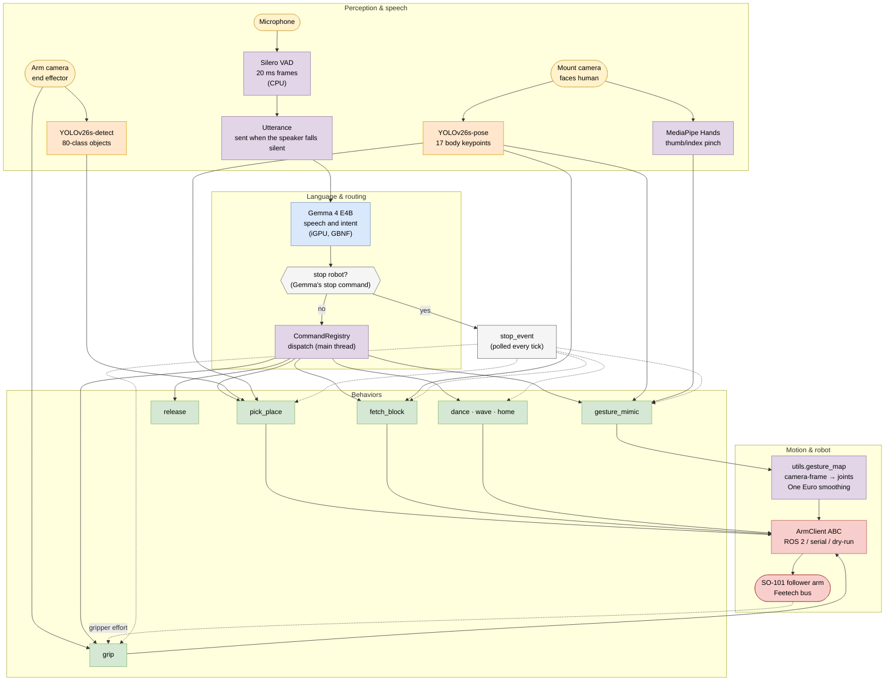
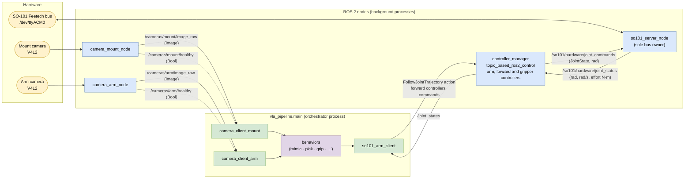

# Strix VVLA Pipeline
Voice-Vision-Language-Action
Gemma4-Yolov26-ROS2

Voice-controlled robot behaviors for the **LeRobot SO-101** arm on an **AMD Ryzen AI APU (Strix Point / Strix Halo, gfx1150 / gfx1151 / gfx1100 for compatibility)** — speech, language, and vision all running locally, split across the NPU, iGPU, and CPU.

The robot has senses: **Gemma 4 is its ears and its brain**, **YOLO is its eyes**, and the **feedback gripper is its sense of touch**. You speak; it hears, understands, looks, and acts.


## Pipeline architecture



Legend — <span title="NPU">🟧 NPU (VitisAI EP)</span> · 🟦 iGPU (ROCm) · 🟪 CPU · 🟩 behavior · 🟥 robot/transport. YOLO-pose and YOLO-detect run on the NPU. Silero runs on the CPU. Gemma 4 E4B runs on the iGPU. See [Compute placement → NPU load order](#npu-load-order-important).

## The robot's senses → an SO-101

Each model maps to a sense, and each sense maps to a part of the arm it informs.

```mermaid
flowchart LR
    subgraph BODY["SO-101 follower arm"]
        direction TB
        BASE["⬣ Base / shoulder_pan<br/>— aims the whole arm"]
        SHOULDER["● shoulder_lift"]
        ELBOW["● elbow_flex"]
        WRIST["● wrist_flex / wrist_roll"]
        JAW["✦ Gripper jaws"]
        BASE --- SHOULDER --- ELBOW --- WRIST --- JAW
    end

    EARS["👂 EARS<br/><b>Silero · CPU</b><br/>which frames are speech"]:::ear
    BRAIN["🧠 BRAIN<br/><b>Gemma 4 E4B · iGPU</b><br/>speech and intent<br/>(one utterance, GBNF)"]:::brain
    EYES["👁 EYES<br/><b>YOLOv26s · NPU</b><br/>pose = where you are<br/>detect = what to grab"]:::eye
    TOUCH["✋ TOUCH<br/><b>Feedback gripper</b><br/>current + position stall<br/>+ camera verify"]:::touch

    EARS ==>|"an utterance<br/>the moment you fall silent"| BRAIN
    BRAIN ==>|"which behavior"| BODY
    EYES ==>|"stop at the first<br/>usable view"| BASE
    EYES ==>|"IK reach to the located object<br/>(shoulder/elbow/wrist)"| ELBOW
    TOUCH ==>|"how hard to hold<br/>(stop on contact)"| JAW
    JAW -.->|"effort feedback"| TOUCH

    classDef ear fill:#dae8fc,stroke:#6c8ebf,color:#000,font-size:14px;
    classDef brain fill:#d5e8d4,stroke:#82b366,color:#000,font-size:14px;
    classDef eye fill:#ffe6cc,stroke:#d79b00,color:#000,font-size:14px;
    classDef touch fill:#f8cecc,stroke:#b85450,color:#000,font-size:14px;
```



**Ears (Silero) → Brain (Gemma 4):** Silero on the CPU marks the 20 ms frames that are speech. They are collected into an utterance, which goes to Gemma 4 E4B on the iGPU the moment the person has been silent for 0.3 s. The grammar lets Gemma emit only the list `["<command>", "<object>", "<words heard>"]`, and the command is acted on as soon as Gemma has written it, before the words. **Eyes (YOLO) → the arm's aim and reach:** YOLO-pose finds *where you are* (drives `shoulder_pan` and the up/down reach for mimicry and handoff), while YOLO-detect finds *what to grab* (grounds "the ball" on a settled sweep, and one stored frame — the camera ray through the box's bottom meeting the table — gives the object's position for one IK reach). **Touch (gripper) → the jaws:** the feedback close loop senses contact through servo current and position stall, confirms with the arm camera, and keeps the goal a little past contact at `Torque_Limit` 500 while both fingers seat, then eases to `hold_torque_limit` for the carry — which is why a pen no longer slips.

## Voice commands → behaviors

Gemma 4 is constrained by `config/intent.gbnf` so it can only emit the list `["<intent>", "<object words>", "<words heard>"]`. A spoken "stop robot" is Gemma's `stop` command; a typed one is matched as a keyword before Gemma is asked. Either interrupts the running behavior. "stop" alone is not a command.

| Say something like | Intent | What happens |
|---|---|---|
| "mirror my arm", "copy my movements" | `gesture_mimic` | YOLO-pose tracks your wrist; a direct camera-frame mapping drives the arm joints to follow your hand (depth from MediaPipe hand size). MediaPipe tracks your thumb–index pinch → gripper. |
| "pick up the ball", "grab the bottle and give it to me" | `pick_place` | YOLO-detect grounds the named object on the arm camera → stop at the first usable view → one table locate → one grasp solve → joint-space descent → feedback grasp → lift it above the other objects and hold it out. The jaws stay closed. |
| "release", "open", "drop it" | `release` | Gemma maps the phrase to `release`. The jaws open where they are and the arm stays put, so the object can be taken or dropped. |
| "fetch the block", "bring me the cube" | `fetch_block` | Approach the block at its taught pose → grasp → lift → find you (YOLO-pose) → extend → release → home. |
| "hold this", "take this pencil" | `grip` | Closes until contact (current/stall + grace window), confirms with the arm camera, then **locks the grip** until "release". A following `gesture_mimic` hands the gripper to your pinch, so the object drops when you open your fingers. |
| "dance", "show me some moves" | `dance` | BPM-paced keyframe choreography. |
| "wave at me", "say hi" | `wave` | Raises the arm and waves `behaviors.wave.cycles` times. |
| "go home" | `home` | Returns to the rest pose. "home" or "reset" alone is not a command. |
| "stop robot" | `stop` | **Interrupts any running behavior immediately.** Spoken, it is Gemma's `stop` command; typed, it is matched as a keyword before Gemma is asked. "stop" alone is not a command. |

## Tested environment

| Component | Version |
|---|---|
| Hardware | AMD Ryzen AI MAX (Strix Halo), iGPU `gfx1151`, XDNA 2 NPU |
| OS | Ubuntu 24.04 |
| ROCm | 7.2.4 |
| Ryzen AI SW | 1.7.1 (VitisAI ONNX Runtime EP) |
| llama.cpp | build 12720 (commit `33aeb17`), built with HIP; Gemma 4 audio needs commit `547765a` or newer |
| Voice model | Gemma 4 E4B-IT, Q4_0 GGUF, with its Q8_0 audio projector (`ggml-org/gemma-4-E4B-it-GGUF`) |
| ROS 2 | Jazzy (required), with ros2_control and the controllers |
| LeRobot | v0.6.0 source, installed without its dependency set. The Feetech SDK is installed separately. |
| PyTorch | 2.11.0+rocm7.13.0 from `repo.amd.com/rocm/whl/<detected gfx>`. The PyPI wheel is not used; it downloads the NVIDIA CUDA stack. |
| Robot | LeRobot SO-101 follower arm |

LeRobot is checked out at v0.6.0 and installed with `--no-deps`. No LeRobot release accepts torchvision 0.26, numpy below 2, and huggingface-hub below 1.0 at the same time. v0.6.0 is the source whose code accepts the ROCm torchvision wheel. numpy and huggingface-hub stay on the pins in `requirements.txt`. The arm packages installed beside it are draccus, the Feetech SDK, pyserial, and deepdiff.

## Compute placement

The pipeline is powered by AI models that utilize every subsystem of the APU. Each workload runs on the subsystem whose strengths best match its requirements.

<table style="border-collapse: collapse">
<thead>
<tr><th style="background-color: rgba(128, 128, 128, 0.2); border: 1px solid rgba(128, 128, 128, 0.4)">Task</th><th style="border: 1px solid rgba(128, 128, 128, 0.4)">Model or algorithm</th><th style="border: 1px solid rgba(128, 128, 128, 0.4)">What it does</th><th style="border: 1px solid rgba(128, 128, 128, 0.4)">Runs on</th><th style="border: 1px solid rgba(128, 128, 128, 0.4)">Runtime</th></tr>
</thead>
<tbody>
<tr style="background-color: rgba(0, 0, 0, 0)"><td rowspan="2" valign="top" style="background-color: rgba(128, 128, 128, 0.2); vertical-align: top; border: 1px solid rgba(128, 128, 128, 0.4)">Voice control</td><td style="border: 1px solid rgba(128, 128, 128, 0.4)">Silero VAD</td><td style="border: 1px solid rgba(128, 128, 128, 0.4)">marks 20 ms frames that contain speech</td><td style="border: 1px solid rgba(128, 128, 128, 0.4)">CPU</td><td style="border: 1px solid rgba(128, 128, 128, 0.4)">ONNX Runtime</td></tr>
<tr style="background-color: rgba(0, 0, 0, 0)"><td style="border: 1px solid rgba(128, 128, 128, 0.4)">Gemma 4 E4B-IT (Q4_0)</td><td style="border: 1px solid rgba(128, 128, 128, 0.4)">an utterance of audio → command</td><td style="border: 1px solid rgba(128, 128, 128, 0.4)">iGPU</td><td style="border: 1px solid rgba(128, 128, 128, 0.4)"><code>llama.cpp</code> <code>llama-server</code> (HIP) and the audio projector</td></tr>
<tr style="background-color: rgba(0, 0, 0, 0)"><td rowspan="2" valign="top" style="background-color: rgba(128, 128, 128, 0.2); vertical-align: top; border: 1px solid rgba(128, 128, 128, 0.4)">Gestures</td><td style="border: 1px solid rgba(128, 128, 128, 0.4)">YOLOv26s-pose</td><td style="border: 1px solid rgba(128, 128, 128, 0.4)">finds your body and wrist</td><td style="border: 1px solid rgba(128, 128, 128, 0.4)">NPU</td><td style="border: 1px solid rgba(128, 128, 128, 0.4)">ONNX Runtime, VitisAI EP</td></tr>
<tr style="background-color: rgba(0, 0, 0, 0)"><td style="border: 1px solid rgba(128, 128, 128, 0.4)">MediaPipe Hands</td><td style="border: 1px solid rgba(128, 128, 128, 0.4)">detects the hand gesture (pinch, roll)</td><td style="border: 1px solid rgba(128, 128, 128, 0.4)">CPU</td><td style="border: 1px solid rgba(128, 128, 128, 0.4)">MediaPipe Tasks</td></tr>
<tr style="background-color: rgba(0, 0, 0, 0)"><td rowspan="2" valign="top" style="background-color: rgba(128, 128, 128, 0.2); vertical-align: top; border: 1px solid rgba(128, 128, 128, 0.4)">Object localization</td><td style="border: 1px solid rgba(128, 128, 128, 0.4)">YOLOv26s-detect</td><td style="border: 1px solid rgba(128, 128, 128, 0.4)">finds the named object in the arm camera</td><td style="border: 1px solid rgba(128, 128, 128, 0.4)">NPU</td><td style="border: 1px solid rgba(128, 128, 128, 0.4)">ONNX Runtime, VitisAI EP</td></tr>
<tr style="background-color: rgba(0, 0, 0, 0)"><td style="border: 1px solid rgba(128, 128, 128, 0.4)">Localization and inverse kinematics</td><td style="border: 1px solid rgba(128, 128, 128, 0.4)">places the object on the table and solves the grasp</td><td style="border: 1px solid rgba(128, 128, 128, 0.4)">CPU</td><td style="border: 1px solid rgba(128, 128, 128, 0.4)">NumPy, MuJoCo</td></tr>
<tr style="background-color: rgba(0, 0, 0, 0)"><td valign="top" style="background-color: rgba(128, 128, 128, 0.2); vertical-align: top; border: 1px solid rgba(128, 128, 128, 0.4)">Digital twin</td><td style="border: 1px solid rgba(128, 128, 128, 0.4)">MuJoCo 3D simulation</td><td style="border: 1px solid rgba(128, 128, 128, 0.4)">simulates the arm and the table scene</td><td style="border: 1px solid rgba(128, 128, 128, 0.4)">CPU (rendering on the iGPU)</td><td style="border: 1px solid rgba(128, 128, 128, 0.4)">MuJoCo, EGL</td></tr>
</tbody>
</table>

An utterance goes to Gemma the moment the person falls silent. [Voice latency](#voice-latency) has the measured times; the samples are not denoised.

Every NPU session is built through one shared factory (`vla_pipeline/utils/npu_session.py`), and each model's `device:` is set in `config/pipeline.yaml`.

### NPU load order (important)

YOLO-pose and YOLO-detect run on the NPU. Voice does not: Silero is on the CPU and Gemma 4 is on the iGPU.

Those two sessions share buffers within a process. The first one sizes them, and they last until the last one closes. Opening YOLO-pose while YOLO-detect is already open fails with `HW context creation unsuccessful / sub buffer size and offset`. `size_npu` opens YOLO-pose first and keeps that session for the life of the process, so the detector can load after it.

A model set to `npu` falls back to CPU, with a warning, if the VitisAI runtime can't give it a session, so the pipeline never crashes over NPU capacity and also runs (slowly) on a plain dev machine. The startup logs say where each model landed.

## ROS 2 nodes & topics

The ROS 2 transport (`robot.use_ros2: true`, `cameras.*.use_ros2: true`) splits the system into background **server nodes** that own the hardware and **client nodes** that live inside the orchestrator process. Only `so101_server_node` ever touches the Feetech bus. It is the hardware side of **ros2_control**: the controllers sit between it and the orchestrator and turn each move into a trajectory. Everything talks over topics and actions, so any node can be restarted, replaced, or watched with `ros2 topic echo` independently.



### Nodes

| Node | Process / how it starts | Role | Owns |
|---|---|---|---|
| `camera_mount_node` | `python -m vla_pipeline.vision.camera_node --role mount` (launch/run_pipeline) | Captures the human-facing camera and publishes frames + health | the mount V4L2 device |
| `camera_arm_node` | `python -m vla_pipeline.vision.camera_node --role arm` | Captures the end-effector camera and publishes frames + health | the arm V4L2 device |
| `so101_server_node` | `python -m vla_pipeline.robot.robot_node --server` (`launch/strix_vla.launch.py`) | **Sole owner of the Feetech bus** and ros2_control's hardware side: writes every setpoint the controllers send at `control_fps`, streams joint state with velocity and gripper effort, owns the `gripper_torque_limit_nm` parameter, parks the arm at rest on shutdown | the SO-101 serial bus |
| `controller_manager` | `ros2_control_node` (`launch/so101_control.launch.py`) | Runs the controllers at `robot.control_fps` on `topic_based_ros2_control`, which reaches `so101_server_node` over the hardware topics. `so101_sim.controller_bringup`, started by the same launch, activates `joint_state_broadcaster`, `arm_controller` and `gripper_forward_controller`, and loads `arm_forward_controller` and `gripper_action_controller` inactive. It sends each request once and takes the next step when the controller manager's status (`/controller_manager/activity`) shows the last one done, so a lost reply does not delay it; ROS's `spawner` waits 10 s for a reply before it asks again | — |
| `robot_state_publisher` | `launch/so101_control.launch.py` | Publishes the SO-101 description (`so101_sim/description/so101.urdf.xacro`) | — |
| `camera_client_mount` | created inside `vla_pipeline.main` (`Ros2Camera`) | Subscribes to the mount image topic, hands the latest frame to behaviors | — |
| `camera_client_arm` | created inside `vla_pipeline.main` (`Ros2Camera`) | Subscribes to the arm image topic for detection / jaw verification | — |
| `so101_arm_client` | created inside `vla_pipeline.main` (`Ros2ArmClient`) | The `ArmClient` behaviors call. A move is one `FollowJointTrajectory` goal to `arm_controller`, timed by the servo profile planner; streamed setpoints (gesture mimic, person tracking) go to `arm_forward_controller`, the gripper to `gripper_forward_controller`; the state is `/joint_states` | — |

The three client nodes spin on their own background executors inside the single orchestrator process, so from the user's side `python -m vla_pipeline.main` is still one plain program.

Joints are radians on the ROS side and LeRobot calibrated degrees in behaviors: the joint map (`so101_sim.mapping.JointMap`) converts at the server's and the client's topics. The gripper's effort is N·m on the wire and `Present_Current` counts in behaviors, through the STS3215 datasheet line in `so101_sim.servo`.

### Topics

| Topic | Type | Publisher → Subscriber | Notes |
|---|---|---|---|
| `/cameras/mount/image_raw` | `sensor_msgs/Image` (bgr8) | `camera_mount_node` → `camera_client_mount` | pose / gesture-mimic / person finding |
| `/cameras/mount/healthy` | `std_msgs/Bool` | `camera_mount_node` → (any) | `false` while the device is offline/reopening |
| `/cameras/arm/image_raw` | `sensor_msgs/Image` (bgr8) | `camera_arm_node` → `camera_client_arm` | object detection + grip jaw verification |
| `/cameras/arm/healthy` | `std_msgs/Bool` | `camera_arm_node` → (any) | health flag for the arm camera |
| `/so101/hardware/joint_commands` | `sensor_msgs/JointState` (rad) | `topic_based_ros2_control` → `so101_server_node` | the controllers' setpoints; the launch remaps `robot.command_topic` here |
| `/so101/hardware/joint_states` | `sensor_msgs/JointState` (rad, rad/s, N·m) | `so101_server_node` → `topic_based_ros2_control` | positions and velocity for all joints; **`effort[gripper]` = gripper torque in N·m** from its current (NaN if the bus can't read it); the launch remaps `robot.state_topic` here |
| `/joint_states` | `sensor_msgs/JointState` | `joint_state_broadcaster` → `so101_arm_client` and anyone | the arm's state for every client |
| `/arm_controller/follow_joint_trajectory` | `control_msgs/action/FollowJointTrajectory` | `so101_arm_client` → `arm_controller` | one goal per move; the result says whether the joints arrived within the goal's tolerance |
| `/arm_forward_controller/commands`, `/gripper_forward_controller/commands` | `std_msgs/Float64MultiArray` (rad) | `so101_arm_client` → the forward controllers | streamed body setpoints; gripper commands |

The camera and hardware topics use best-effort, keep-last depth-1 QoS — the latest frame/state always wins and vision never backs up behind a slow consumer; the controllers' topics and actions use the ROS defaults. Camera frames (0.9 MB each) travel on Fast DDS's `LARGE_DATA` transports: on the default ones, frames were lost for up to 1.7 s at a time while the pipeline ran. `scripts/ryzen_ai_env.sh` sets `FASTDDS_BUILTIN_TRANSPORTS=LARGE_DATA`, so source it (or `activate_venv.sh`) in any shell that watches the camera topics. Every camera parameter (device, resolution, fps, rotation, topic) is a ROS parameter with defaults from `cameras:` in `config/pipeline.yaml`; point `cameras.arm.device` at the end-effector camera (a `/dev/v4l/by-id/...` path is more stable than an index) and set `rotate` to match its mounting. If a camera is unplugged the node stays up, publishes `healthy: false`, retries every `reopen_interval_s`, and behaviors degrade gracefully (pick-and-place says the arm camera is offline and does not pick; fetch hands off straight ahead).

Quick inspection:

```bash
ros2 node list                       # camera_mount_node, camera_arm_node, so101_server_node, controller_manager, ...
ros2 control list_controllers        # which controllers are active
ros2 topic hz /cameras/arm/image_raw # confirm the arm camera is publishing
ros2 topic echo /joint_states        # positions (rad) + gripper effort (N·m)
```

### Digital twin

`--digital-twin` replaces the arm server and the arm camera with `so101_sim.node`. It hosts the pipeline's own `So101ServerNode` on a simulated Feetech bus and renders the arm camera from the same physics, under the same controllers. The twin's physics is paced to the wall clock, like the real arm, and it does not publish `/clock`: every node keeps the wall-clock time the real arm runs on. Its extra service `/sim/reset_scene` puts the props back; the console's `r` key parks the arm through the controllers first, then calls it.

## Repository layout

```
vvla-pipeline/
├── bootstrap.sh                  # one-shot setup into a uv venv at ./.venv
├── run_pipeline.sh               # entry point: starts camera + arm nodes, then the orchestrator
├── activate_venv.sh              # source it: ROS 2 + .venv + the NPU runtime environment
├── arm_calibrator/               # one-pose servo calibration (see its README)
├── so101_sim/                    # MuJoCo digital twin (arm, cameras, table scene, ROS 2 node),
│                                 #   the SO-101 description and the ros2_control names (control.py)
├── ros_ws/                       # colcon workspace: bootstrap.sh builds topic_based_ros2_control here
├── patches/                      # patches bootstrap.sh applies to topic_based_ros2_control
├── tests/                        # automated tests: the stacks on the twin, the notebooks (see below)
├── workshop/                     # the hands-on workshop, with its own copy of the behavior code (common/)
├── config/
│   ├── pipeline.yaml             # all tunables (cameras, gemma4-e4b-it, gesture_mimic, pick_place, grip, …)
│   ├── intent.gbnf               # GBNF grammar: the list [command, object, words heard]
│   └── vaiep_config.json         # VitisAI compiler config for YOLO (BF16, VAIML)
├── launch/
│   ├── strix_vla.launch.py       # cameras (mount+arm) + SO-101 server node (or the twin) + controllers
│   └── so101_control.launch.py   # robot_state_publisher, ros2_control_node, the controllers' bring-up
├── scripts/
│   ├── calibrate_arm_camera.py   # arm camera intrinsics + mount on the gripper (pick_place IK)
│   ├── compile_npu_models.{py,sh} # compile the YOLO ONNX for the NPU (SDK venv)
│   ├── ensure_voice.sh           # Gemma 4 GGUF, audio projector, Silero, llama-server check
│   ├── export_yolo26s_pose.py    # body-keypoint ONNX export
│   ├── export_yolo26s_detect.py  # 80-class detection ONNX export
│   ├── ryzen_ai_env.sh           # LD_LIBRARY_PATH for the VitisAI EP runtime
│   ├── verify_npu_stack.py       # check that the VitisAI EP loads
│   ├── validate_setup.sh         # check scripts, SDK, caches and .venv
│   └── install_kernel.sh         # register .venv Jupyter kernel; ensure_voice.sh checks the voice files
└── vla_pipeline/
    ├── main.py                   # orchestrator: handler registry, listener thread
    ├── dispatch.py               # transcript checks, stop fast path, behavior dispatch loop
    ├── console.py                # twin console window (--digital-twin)
    ├── audio/
    │   └── gemma_listen.py       # offset removal, the utterance cut, the level raise
    ├── llm/
    │   ├── intents.py            # Intent enum, ParsedCommand, CommandRegistry, system prompt
    │   ├── llama_intent.py       # llama-server lifecycle + Gemma audio and text parsing
    │   └── voice.py              # the microphone thread; voice_intent gemma4-e4b-it
    ├── vision/
    │   ├── camera.py             # CameraClient (direct / ROS 2) per role
    │   ├── camera_node.py        # ROS 2 camera publisher node
    │   ├── yolo_pose_npu.py      # PoseEstimator: letterbox, infer, COCO-17 kpts
    │   ├── yolo_detect_npu.py    # ObjectDetector + spoken-name synonyms
    │   └── mediapipe_hands.py    # HandTracker: normalized thumb–index pinch
    ├── robot/
    │   ├── arm_interface.py      # ArmClient, DirectArm, BusOwnerArm, DryRunArm, clamp_joints, calibration
    │   ├── sim_arm.py            # SimArmClient: DirectArm on the digital twin
    │   ├── servo_profile.py      # per-move servo speed/acceleration and duration from the arm model
    │   ├── ros2_control_arm.py   # ControllerArm: moves as trajectory goals, streaming, gripper, state
    │   ├── robot_node.py         # So101ServerNode (ros2_control's hardware side) + Ros2ArmClient
    │   └── test_ros2_arm_motion.py  # ROS 2 per-joint full-range motion test
    ├── behaviors/
    │   ├── manipulation.py       # grip, pick and place, fetch: the feedback close, the scan, IK reach, handover
    │   ├── gesture_mimic.py      # camera-frame mapping loop (pinch -> gripper), --calibrate-depth/-grip
    │   ├── pick_place.py         # run_pick_place(cfg, arm, ...) -> manipulation.py
    │   ├── fetch_block.py        # run_fetch_block(cfg, arm, ...) -> manipulation.py
    │   ├── grip.py               # run_grip / run_release(cfg, arm, ...) -> manipulation.py
    │   ├── dance.py              # keyframe moves, BPM pacing
    │   └── simple.py             # wave, home
    └── utils/
        ├── config.py             # YAML loader, path resolution
        ├── npu_session.py        # shared VitisAI/CPU ONNX session factory
        ├── gesture_map.py        # camera-frame → joint mapping (MimicMapper, One Euro filter)
        └── resource_monitor.py   # CPU/GPU/NPU power, VRAM, DRAM bandwidth
```

The pipeline and the workshop each keep their own copy of the arm layer, the servo profile planner, the ros2_control client, the manipulation behaviors and the gesture mapper: the pipeline runs on its own, and the workshop is a lesson students edit. `tests/sim/test_copies.py` compares the two as code and fails when they drift apart.

## Installation

Ubuntu 24.04, kernel 6.10 or newer, Python 3.12. 64 GB of RAM is recommended. Three stages: the NPU driver, Ryzen AI Software 1.7.1, then this repository. Driver details match the [Ryzen AI 1.7.1 Linux instructions](https://ryzenai.docs.amd.com/en/1.7.1/linux.html).

Download both packages from the Ryzen AI Software downloads page:

- [NPU drivers, `RAI_1.7.1_Linux_NPU_XRT.zip`](https://account.amd.com/en/forms/downloads/xef.html?filename=RAI_1.7.1_Linux_NPU_XRT.zip)
- [Ryzen AI Software, `ryzen_ai-1.7.1.tgz`](https://account.amd.com/en/forms/downloads/xef.html?filename=ryzen_ai-1.7.1.tgz)

### 1. NPU driver

The NPU PCI id is `1022:17f0`. If that search prints nothing, stop. The zip may unpack into a subdirectory, so `find` lands in the directory that holds the `.deb` files. `xrt-smi examine` must list a device (`RyzenAI-npu5`, `NPU Strix`, or `NPU Strix Halo`). If the table is empty, stop.

```bash
sudo apt update
sudo apt install -y python3.12 python3.12-venv libboost-filesystem1.74.0 dkms
lspci -nn | grep 1022:17f0
cd ~/Downloads
unzip -o RAI_1.7.1_Linux_NPU_XRT.zip -d RAI_1.7.1_Linux_NPU_XRT
cd "$(dirname "$(find RAI_1.7.1_Linux_NPU_XRT -name 'xrt_202610.2.21.75_24.04-amd64-base.deb' -print -quit)")"
sudo apt install --fix-broken -y \
  ./xrt_202610.2.21.75_24.04-amd64-base.deb \
  ./xrt_202610.2.21.75_24.04-amd64-base-dev.deb \
  ./xrt_202610.2.21.75_24.04-amd64-npu.deb \
  ./xrt_plugin.2.21.260102.53.release_24.04-amd64-amdxdna.deb
export LD_LIBRARY_PATH="/lib/x86_64-linux-gnu:${LD_LIBRARY_PATH:-}"
source /opt/xilinx/xrt/setup.sh
xrt-smi examine
```

### 2. Ryzen AI Software

This creates `~/ryzen_ai-1.7.1/venv`. Do not unpack the SDK inside this repository. `venv/quicktest/quicktest.py` is the SDK's own NPU check: it compiles a small CNN and prints `Test Finished`, and the provider list includes `VitisAIExecutionProvider`.

```bash
mkdir -p ~/ryzen_ai-1.7.1
cd ~/ryzen_ai-1.7.1
tar -xvzf ~/Downloads/ryzen_ai-1.7.1.tgz
./install_ryzen_ai.sh -a yes -p $PWD/venv
```

### 3. This repository

Clone once. Do not clone this repository again inside the workshop. Ultralytics is AGPL-3.0, so `./bootstrap.sh` does not install it or export the YOLO ONNX files. The first bootstrap passes `--skip-compile` because those files do not exist yet. The second one compiles them.

```bash
git clone https://github.com/amd/embedded-x86-ai
cd embedded-x86-ai/workshops/vvla-pipeline
export RYZEN_AI_WHEELS=~/ryzen_ai-1.7.1
./bootstrap.sh --skip-compile
source .venv/bin/activate
pip install 'ultralytics' 'onnxslim>=0.1.82' 'numpy==1.26.4' 'opencv-contrib-python==4.11.0.86'
python scripts/export_yolo26s_pose.py
python scripts/export_yolo26s_detect.py
./bootstrap.sh --skip-apt --skip-llama --skip-models
```

`./bootstrap.sh` installs the apt packages, ROCm, the `.venv`, the ROCm PyTorch wheels, LeRobot v0.6.0 without its dependency set, and llama.cpp with HIP (gfx1100 on Strix). A checkout on another LeRobot release is moved to v0.6.0. numpy stays below 2 and huggingface-hub stays on 0.34.2 through 0.35.x, because those are the pins in `requirements.txt`. ONNX Runtime needs the numpy 1.x ABI, and transformers needs huggingface-hub below 1.0. It downloads the Gemma 4 E4B GGUF and its audio projector with `hf download` from `ggml-org/gemma-4-E4B-it-GGUF`, and Silero VAD v6.2.3, through `scripts/ensure_voice.sh`. It installs ROS 2 Jazzy when it is absent, plus ros2_control, the controllers, and `topic_based_ros2_control` 0.3.0 with the patches in `patches/topic_based_ros2_control/`, and builds that into `ros_ws/`. The second run writes `cache/yolo26s_pose_fp32/` and `cache/yolo26s_detect_fp32/` (about 16 minutes and 3 minutes). `./run_pipeline.sh` sources the venv, ROS 2, and `scripts/ryzen_ai_env.sh`.

`cache/` is not in git and does not copy to another machine: a cache from a different compiler loads and then mis-detects (`recompile model with latest VAIML version`). Delete the two directories above and run the second bootstrap again on this machine. To rebuild one model, remove its directory and run `scripts/compile_npu_models.sh --only yolo_pose` (or `yolo_detect`). When those `.rai` files were already compiled here, skip the export and the second bootstrap: `./bootstrap.sh --skip-compile` is the whole repository step. Other flags are `--skip-apt`, `--skip-llama`, `--skip-models`, and `--cpu-only`.

`scripts/verify_npu_stack.py --preflight` confirms the VitisAI provider. `scripts/ensure_voice.sh` confirms the Gemma GGUF, the audio projector, Silero, and a `llama-server` built with Gemma 4 audio.

### Robot prerequisites (hardware runs only)

```bash
lerobot-find-port                 # find the Feetech bus, e.g. /dev/ttyACM0
sudo chmod 666 /dev/ttyACM0       # or add a udev rule
```

Then set `motor_port` and `robot_id` in `config/pipeline.yaml`.

**Calibration.** The SO-101 needs a one-time calibration file at `~/.cache/huggingface/lerobot/calibration/robots/*/<robot_id>.json`. Two tools write it:

- [`arm_calibrator/`](arm_calibrator/README.md) takes one pose: put the arm in its home pose and press Enter. It writes the homing offsets to the servos and installs the file for `robot_id: my_awesome_follower_arm`. The joint ranges come from a reference arm.
- LeRobot's interactive calibration also has you sweep each joint to measure this arm's ranges. If the file is missing, `run_pipeline.sh` runs it **in the foreground** before starting anything in the background (it prompts you, so it can't run in a backgrounded node). You can also run it on its own at any time:

```bash
python -m vla_pipeline.robot.arm_interface --calibrate           # once, if missing
python -m vla_pipeline.robot.arm_interface --calibrate --force   # redo
```

After the file exists, subsequent launches skip straight to startup.

## Running the full pipeline

```bash
./run_pipeline.sh                     # voice control, full hardware
./run_pipeline.sh --text-commands     # type commands instead of speaking
./run_pipeline.sh --dry-run           # no robot hardware (prints joint targets)
./run_pipeline.sh --digital-twin      # no robot hardware: the MuJoCo twin, shown in the twin console window
./run_pipeline.sh --headless          # no OpenCV preview windows
```

The script sources ROS 2 Jazzy, the venv and the Ryzen AI NPU environment (`scripts/ryzen_ai_env.sh`), runs first-time calibration if needed (foreground), starts the SO-101 server node, its ros2_control controllers **and both camera nodes** in the background (when `robot.use_ros2: true` / `cameras.*.use_ros2: true`), runs the orchestrator, and tears everything down on Ctrl-C — the arm always parks at the rest pose. With `robot.use_ros2: false` the orchestrator owns the bus itself (`BusOwnerArm`): one thread writes each goal and reads the servos every control tick. Equivalent ROS launch:

```bash
ros2 launch launch/strix_vla.launch.py            # cameras + arm server + controllers
ros2 launch launch/strix_vla.launch.py dry_run:=true
source scripts/ryzen_ai_env.sh                    # orchestrator terminal: NPU runtime for YOLO
python -m vla_pipeline.main                       # orchestrator (own terminal)
```

A resource-usage CSV (CPU %, RAPL package power, iGPU busy %/VRAM via `rocm-smi`, DRAM bandwidth via AMD perf events) is written to `logs/` on every run. [Compute placement](#compute-placement) lists which model runs on which device.

## Gesture mimicry: direct camera-frame mapping

Mimicry maps the camera image straight onto SO-101 joints (`MimicMapper` in `vla_pipeline/utils/gesture_map.py`): the image is treated as a control surface, and four normalized axes in `[-1, 1]` drive per-joint offsets from a neutral "ready" pose, every command clamped to the joint limits (no analytic IK, no arm-geometry solve). All gains live under `behaviors.gesture_mimic` in `config/pipeline.yaml`.

1. **Left/right (x)** from the YOLO-pose wrist keypoint's horizontal position → `shoulder_pan`.
2. **Up/down (y)** from the wrist keypoint's vertical position → `elbow_flex` at full authority, `shoulder_lift` at its lower ~50%, and `wrist_flex` as a level-keeping fine-tune. The YOLO wrist is also the fallback controller: when MediaPipe loses the hand the arm keeps following it for x/y.
3. **Depth from hand size**: MediaPipe hand span in pixels ∝ 1/distance → forward/back, extending `shoulder_lift` through its upper half with `elbow_flex` going negative. The neutral size auto-calibrates from the first frames (or set `hand_size_neutral`).
4. **Wrist roll** from the MediaPipe directed thumb→index vector (knuckle-line, then wrist→knuckle, as reliability-weighted fallbacks; all unwrapped so roll only moves on a real rotation).
5. **One Euro filter** on the four control axes (smooth at rest, low lag in motion; tune `behaviors.gesture_mimic.smoothing.min_cutoff` for rest jitter, `beta` for lag).

The gripper follows the MediaPipe thumb↔index distance as a continuous ramp: held closed within the first `grip_close_frac` of the calibrated `grip_min`..`grip_max` range, then opening linearly to `grip_open_pos` (~90%). It holds its last position whenever the hand is unseen. Until the first thumb↔index distance is measured the gripper is not commanded, so a held object stays held.

### Depth and grip calibration (one-time)

```bash
python -m vla_pipeline.behaviors.gesture_mimic --calibrate-depth   # neutral hand size (depth)
python -m vla_pipeline.behaviors.gesture_mimic --calibrate-grip    # thumb↔index min/max (gripper)
```

Hold your hand at a comfortable mid-distance, then paste the printed `hand_size_neutral` into `behaviors.gesture_mimic` in `config/pipeline.yaml`; with `hand_size_neutral: 0` the neutral auto-calibrates from the first few frames instead. `--calibrate-grip` has you pinch and then spread your fingers to measure `grip_min`/`grip_max` for the gripper ramp.

### Pose backend choice

Kept: **YOLOv26s-pose on the NPU for the body + MediaPipe Hands on CPU for the pinch.** Rationale: the NPU session is already compiled/cached, runs at camera rate without touching CPU/iGPU budgets needed by Gemma and MediaPipe, and COCO-17 keypoints are exactly what the mapper needs; MediaPipe Hands remains the best cheap pinch detector. The often-suggested alternative — MediaPipe Pose with world landmarks (metric 3-D, CPU) — would give Z without calibration, but costs CPU it would share with MediaPipe Hands, adds a second pose stack to fuse, and its world-landmark Z is noisy enough at 2-3 m that it needs the same One Euro treatment anyway. The mapper is backend-agnostic (consumes COCO-17 arrays), so swapping the estimator later is a one-file change.

## Gripper: closing on contact

`close_with_feedback` in `vla_pipeline/behaviors/manipulation.py` closes the jaws step by step and stops at the first contact. Grip, fetch, and pick and place all use it. Each step waits for the arm owner's next state (`ArmClient.wait_state`), so the close runs on the clock of whatever reports the arm: the servos' bus owner, the controllers' `/joint_states`, or the twin's physics.

- **Contact** is sustained servo current above `grip.load_threshold` while the jaws have stopped closing, when the bus reports current (over ROS 2 it rides in `JointState.effort` as N·m, and the client turns it back into current counts), otherwise a position stall: the jaws stopped short of the command.
- A **grace window** (`grip.stall_grace_s`) keeps sampling after the command reaches the closed floor, so a thin object such as a pen still counts as contact.
- After contact the goal stays `hold_past_contact` past the jaw for `reseat_s` while both fingers seat, then the torque limit drops to `hold_torque_limit` for the carry.
- `grip` also compares the arm camera's view of the jaws before and after (`grip.jaw_roi`, `grip.jaw_diff_threshold`), so a false contact is reported as a failure instead of a phantom grip-lock.

## Voice latency

A sentence is sent the moment it has ended, and its command is acted on the moment Gemma has written it.

1. **The utterance.** A constant offset is first taken out of the microphone's samples (a built-in microphone was measured to deliver samples around +1028, which alone reads −30 dBFS). Silero marks each 20 ms frame as speech or not. An utterance starts at the first speech frame, with `pre_roll_ms` (300 ms) of the sound before it, and is sent on the frame that completes `end_silence_ms` (300 ms) of silence: one request per sentence. Gemma takes a whole clip, not sound as it comes, so the end of the speech is the earliest moment a sentence can be sent. An utterance is at most `window_s` (6 s) long; one with less than `min_voice_ms` (100 ms) of speech is dropped. It is raised to a fixed level before it is sent, because Gemma hears quiet sound worse.
2. **The answer.** Gemma writes the list `["<command>", "<object>", "<words heard>"]`, and the client reads it as it is written. The command and the object come first: the behavior starts when they are complete, while Gemma still writes the words it heard. The words are shown when they arrive. An utterance that holds no command ends its request there. A typed sentence ends its request at the command too.
3. **The warm-up.** One request is sent when the server has started, so the first spoken command does not pay for the model reading in its instructions.

Measured on a Strix Halo (Ryzen AI Max+ 395) with sentences of a synthetic voice played in real time through the listener and the real Gemma, from the end of a sentence to its command:

| Listener | min / median / max |
|---|---|
| before: the last 6 s of sound sent every 2 s, the whole answer awaited | 0.87 / 2.01 / 2.22 s |
| now: one utterance, the command acted on when written | 0.45 / 0.46 / 0.71 s |

The second row was measured on 2026-11-25 with llama.cpp build 12720; an earlier build, 11548, gave 0.55 / 0.55 / 0.77 s for the same listener. Of the 0.46 s, 0.3 s is the end silence and 0.15 s is the request up to the command; the words heard follow 0.11 to 0.16 s later. The slowest of the six sentences is "pick up the ball", the first one and the only one with an object: its request takes 0.39 s to the command. Every command logs its own time: `Command 'home' 0.46 s after the end of the speech (request 0.15 s to the call)`. `tests/sim/test_voice_live.py` repeats the measurement.

Two more measurements, both on the same machine:

- **A person at the microphone, with two talk shows playing beside it** (2026-11-25, the digital twin notebook running, the first 14 minutes, times from the `llama-server` log). Of 96 requests, 67 ended at the call, which is where a sentence without a command ends: 0.21 / 0.24 / 0.34 s (min / median / max). The 29 spoken commands were read to the end, words included, in 0.29 / 0.44 / 0.56 s. The person reported that the commands were understood over the other voices. The time from the end of a spoken sentence to its command was not logged in that session.
- **While the digital twin renders on the same iGPU.** A spoken clip's request takes 3 % longer up to the command: 0.227 s instead of 0.220 s (median), with the twin rendering its wrist, mount and 3-D views.

A spoken "stop robot" is a command Gemma returns like any other, so a stop takes the same time. "stop" alone does nothing.

### No denoiser

An utterance is sent with the microphone's constant offset taken out and raised to a fixed level; nothing else is done to it. There is no noise-suppression stage. Google's audio guide for Gemma 4 specifies one channel, 16 kHz, float samples from −1 to 1, and a Fourier resample. It does not specify a denoiser ([Audio understanding](https://ai.google.dev/gemma/docs/capabilities/audio)).

A cleaner in front of this model is a poor trade. Gemma 4 E4B is weaker on noisy spontaneous speech than on clean read speech, and it inserts words when the audio is hard ([Open ASR write-up](https://twango.dev/writing/gemma4-asr-benchmark)). A 20-clip noisy-English set measured 7.6% word error ([TypeWhisper](https://typewhisper.github.io/typewhisper-benchmark/?model=crispasr%3Agemma4-e4b-it-q8_0&view=model)). MetricGAN raised the error for Whisper, Parakeet, and Gemini on every noise condition tried, including clips that were already clean ([When De-noising Hurts](https://arxiv.org/html/2512.17562)). SAM-Audio separation raised the signal-to-noise ratio and still raised Whisper's word error ([When Audio Separation Hurts](https://arxiv.org/html/2603.04710v2)). On large audio-language models, ordinary denoisers sometimes made the internal noise measure worse ([SEE](https://arxiv.org/html/2601.07331)). The enhancer invents a spectrum the encoder was not trained on, and the language model then guesses the missing words.

A tradeshow floor is another person talking. Silero treats that as speech and passes it. Separating one voice out of a crowd is the approach those measurements found raised error. A mild steady-noise suppressor (RNNoise or DeepFilterNet, gain only where speech is absent) is a later experiment for a fan louder than the visitors, scored by whether the command intent still matches. It is not this path. The NPU overlay is unrelated: Gemma's audio encoder runs on the iGPU through `llama-server`.

## Voice pick-and-place

"Pick up the ball" → the command `pick_place` with the object `ball` → `run_pick_place` in `vla_pipeline/behaviors/manipulation.py`: the arm walks `scan_pans` and stops at the first settled frame with a usable box, kept with the joints that took it → YOLOv26s-detect on the arm camera grounds the name (synonym table: ball→sports ball, mug→cup, …) → that box is located once on the table → one grasp solve → a joint-space descent → the same feedback-based close as grip, a short settle, a holding check (one fresh frame and one more locate if the grasp slips) → lift the grasp above the other objects and hold the object out toward the operator. The jaws stay closed.

**Locate:** objects rest on the table, so one camera is enough. Forward kinematics of the SO-101 model (`so101_sim/src/so101_sim/kinematics.py`) at the current joint angles gives the wrist camera's pose; rays through the YOLO box meet the table plane, then a class-specific footprint is fitted: sphere for a sports ball, upright bottle, or flat footprint for a book/toothbrush. For the elongated toothbrush, YOLO supplies the crop but not an angle: PCA on the pixels inside that crop finds its long image axis and camera rays carry it onto the table. **IK reach:** one five-joint constrained SQP solve uses MuJoCo's analytic point and angular Jacobians to put the point between the open jaws on the object, keep the closing axis horizontal, and (for a toothbrush) make the jaws close across its long axis. Beside a ball or other lying object, the hand then moves sideways at grasp height until the fixed finger is `fixed_jaw_gap_m` (5 mm) away, so the moving jaw only pushes the object that far instead of across half the jaw opening. Joint limits and a per-step trust region are hard constraints; geometric SO-101 elbow solutions seed the optimizer, while MuJoCo FK remains the source of truth. The jaws then open above the object and descend in joint space. Each step stays within 5 mm of the planned vertical and above the table; when a joint line leaves that band, the same bound is met with Cartesian steps. Reach is ~14–30 cm from the base. A box cut by the image edge is skipped and the next stored frame is located. An object that cannot be solved is out of reach, and the arm says so. Only the arm camera can locate an object, so with it offline the arm says so and does not pick.

**Real arm calibration.** A real arm (`robot.backend: real`) does not pick until its camera is calibrated: with `cameras.arm.intrinsics` or `cameras.arm.extrinsics` unset, the robot says "The arm camera isn't calibrated: run scripts/calibrate_arm_camera.py" and the behavior ends as failed before the arm moves. The twin's `wrist_cam` model (intrinsics and pose on the gripper) is exact on the twin only; it matches a real camera only if it is mounted exactly like the twin's, and 1° of mount error moves the fix ~5 mm at 30 cm. With the pipeline stopped:

```bash
python scripts/calibrate_arm_camera.py intrinsics --board 9x6 --square-mm 24   # printed checkerboard, 12+ views
python scripts/calibrate_arm_camera.py mount --board 9x6 --square-mm 24        # board taped to the table, ~8 jogged arm poses
python scripts/calibrate_arm_camera.py check --object sports_ball --at 0.28 0.06  # twin body at a measured spot
```

Each prints the YAML for `cameras.arm.intrinsics` / `cameras.arm.extrinsics` (the same keys exist in the workshop's `config/workshop.yaml`). `check --sim` runs on the twin.

Failure handling speaks, and a behavior that gives up ends as failed (not "done"): unknown word ("I don't know what that looks like"), nothing found, ambiguous matches, failed/slipped grasp (retry then give up), dropped after the lift, the arm camera offline (before the scan, or at the first pan without a frame), a real arm whose camera is not calibrated (asks for `scripts/calibrate_arm_camera.py`). The arm walks the configured `scan_pans` from `scan_pose` and stops at the first settled frame with a usable box, keeping that frame with the joints that took it. A miss or a box cut by the image edge does not stop the walk. If the walk stores nothing, it moves to `scan_near_pose` and walks `scan_near_pans`; this pulled-back, downward view exposes the near-base table normally hidden behind the jaws. Ball, bottle, book, and toothbrush share that rule. The default toothbrush is visible on the high sweep, so that run never enters the near pose, and a transfer away from a pose follows the joint line. One successful locate and one grasp solve follow the ranked frames. The physical camera mount never changes. The twin scene uses four textured props that are actual COCO-80 classes: sports ball, book, bottle, and toothbrush. COCO still has no `cube` or `pen` class; those names fail safely unless YOLO is fine-tuned and `SYNONYMS` is extended. One-time setup: `python scripts/export_yolo26s_detect.py`.

**Current twin manipulation limits.** Detection and the ball's first pick work,
and the bottle is solved around its standing footprint. The book is too large
for the current grasp. The default toothbrush is found on the high sweep. One
stored frame measures its long axis, one solve turns the wrist across it, and
the arm descends in joint space. After the ball is dropped, its new pose is not reliably
reacquired for a second pick. These are known manipulation and recovery
limitations. A bottle on its side is a separate detection miss: the same YOLO
scores the upright bottle as bottle and the bottle on its side as banana, so
the scan says it cannot see a bottle and the grasp never starts.

## Adding a voice command

1. Add the member to `Intent` and one line to `INTENT_SYSTEM_PROMPT` (`vla_pipeline/llm/intents.py`).
2. Add the name to the `cmd` rule in `config/intent.gbnf`.
3. Register a handler in `vla_pipeline/main.py`: `@registry.register(Intent.MY_COMMAND)` — it receives `(ctx, cmd)` with the arm, cameras, models, `cmd.params`, and `ctx.stop_check`.

`wave` and `home` (`vla_pipeline/behaviors/simple.py`) are the template. `stop robot` (Gemma's `stop` command when spoken, a keyword match when typed) interrupts any running behavior — including mid-move (every move's wait checks `stop_check`). "stop" alone is not a command.

## Testing each component independently

Most components are standalone modules with their own `__main__` self-test. Pick and place, fetch, grip and the camera-to-joint mapping are tested on the digital twin.

| Component | Needs hardware? | Command |
|---|---|---|
| Camera→joint mapping (One Euro/depth) | no (twin) | `./run_sim_tests.sh -k mimic` |
| Intent grammar + parser | Gemma server running | `python -m vla_pipeline.llm.llama_intent --selftest` |
| Spoken sentences → commands, with their times | no (a synthetic voice stands in for the microphone; the real Gemma on the iGPU) | `./run_sim_tests.sh -k voice_live -s` |
| YOLO pose | webcam | `python -m vla_pipeline.vision.yolo_pose_npu --device npu` |
| YOLO detect | webcam | `python -m vla_pipeline.vision.yolo_detect_npu --find ball --role arm` |
| MediaPipe hands | webcam | `python -m vla_pipeline.vision.mediapipe_hands` |
| Camera client | webcam | `python -m vla_pipeline.vision.camera --role mount` |
| Camera node | ROS 2 + webcam | `python -m vla_pipeline.vision.camera_node --role arm` |
| Arm interface | no (`--dry-run`) / arm | `python -m vla_pipeline.robot.arm_interface --dry-run` |
| Arm calibration | arm | `python -m vla_pipeline.robot.arm_interface --calibrate` |
| ROS 2 server node + controllers | ROS 2 (arm optional) | `ros2 launch launch/strix_vla.launch.py cameras:=false dry_run:=true` |
| ROS 2 client round-trip | ROS 2, the line above running | `python -m vla_pipeline.robot.robot_node --client-test` |
| ROS 2 full-range motion | arm | `python -m vla_pipeline.robot.test_ros2_arm_motion` |
| Gesture mimic | webcam | `python -m vla_pipeline.behaviors.gesture_mimic --dry-run` |
| Pick and place | no (twin) | `./run_sim_tests.sh -k pick` |
| Arm camera localization | arm (`--sim` = twin) | `python scripts/calibrate_arm_camera.py check --sim --object sports_ball --pan -14 --at 0.28 0.06` |
| Fetch block | no (twin) | `./run_sim_tests.sh -k fetch_block` |
| Dance | no | `python -m vla_pipeline.behaviors.dance --dry-run` |
| Grip | no (twin) | `./run_sim_tests.sh -k grip` |
| Wave / home | no | `python -m vla_pipeline.behaviors.simple --behavior wave --dry-run` |

A lightweight **always-on-top resource HUD** for live demos ships with the
workshop: `workshop/launch_monitor.sh` (or `from common.monitor import
open_monitor` inside a notebook) floats **CPU %**, **GPU %**, and **NPU
inferences/sec** (or Idle) over every window - the consolidated cousin of
`utils/resource_monitor.py` above.

## Automated tests

Two commands. A CI runner on a Ryzen AI machine runs both. On a Strix Halo the pair takes about 20 minutes.

```bash
cd workshop && ./run_notebooks.sh --test    # notebooks and the Instructor's corner
./run_sim_tests.sh                          # NPU load order and the twin stacks
```

`./run_notebooks.sh --test` does the setup [workshop/README.md](workshop/README.md) describes: the `.venv`, the Ryzen AI runtime, ROS 2, the `vvla-workshop` kernel, and the check of the Gemma files and `llama-server` (`scripts/ensure_voice.sh`). Then it runs the notebooks in `workshop/notebooks/`, in the README's order, and the README's Instructor's corner commands. A notebook that needs Gemma starts its own `llama-server`.

`./run_sim_tests.sh` uses the same `.venv`, Ryzen AI runtime, and ROS 2. It runs `pytest tests/npu`, then `pytest tests/sim -m "sim and not docs"`. Arguments after the command go to the twin tests only. It does not start Jupyter (the one `llama-server` in it is the one `tests/sim/test_voice_live.py` starts for itself), and it does not run the tests marked `docs` (the notebooks, the Instructor's corner, and the notebook console). Those belong to `./run_notebooks.sh --test`, which stands in a generated frame for the webcam and a scripted person for pose. The notebook reads that frame in this process. It does not open `/dev/video0` or wait on `/cameras/mount/image_raw`. A notebook under test has no microphone (opening one fails, as on a machine without one) and asks Gemma on a free port of its own, so it neither hears the room nor shares a `llama-server` with a notebook open on the same machine. One test speaks to the notebook: in `tests/sim/test_twin_notebook_voice.py` the kernel's microphone plays a synthetic voice in real time. It answers the notebook's "say one command" cell, then says to the console, one after the other, "give me a wave", a question, "pick up the ball", "open your hand" and "go home". Each command must run when its turn comes (the arm waves, the ball is held up, then let go, the arm is at rest), and the question must run nothing.

In `./run_sim_tests.sh` spoken commands are injected as text, except in `tests/sim/test_voice_live.py`: there a stand-in microphone plays six sentences of a synthetic voice (espeak-ng, `libespeak-ng1`) in real time through the real listener, and a `llama-server` the test starts answers them with the real Gemma. The same file asks the real Gemma the typed stop sentences: "stop robot" in four forms must stop, and "stop", "halt", "freeze", "stop it", "abort" and "stop talking" must do nothing. The operator's pose and hands are scripted. The arm camera is read by YOLO on the NPU (`--sim-eyes seg` substitutes the twin's segmentation boxes). The twin stands in for the arm and its camera, and its rendering runs on the iGPU. No arm, camera, or microphone has to be attached. The ROS cases run headless on a private ROS domain, and the exit code is the result.

Spoken commands, and how each one is checked. A cell is blank when that stack does not run the case. "Parks at rest" means the body joints finish within 4° of the rest pose.

| Use case | Command | Pipeline, in process | Workshop, in process | Workshop over ROS 2 |
|---|---|---|---|---|
| Wave | `wave at me` | `wave` starts and ends ok. The LLM request carries a grammar and temperature 0. The elbow goes below −35° and the pan passes +20° and −20°. Parks at rest. | | Pan span is greater than 40°. |
| Stop a wave | `wave`, then `stop robot` | `stop` is the keyword path: one transcript is parsed, and it is not `stop`. The elbow goal moves within 150 ms, and the pan goal does not return to ±25° after that. The wave ends stopped. Parks at rest. | | |
| Startup noise | `wave`, `thank you.`, `you`, `...` inside a 1 s grace window | Dropped as grace, then three noises. The mock LLM receives nothing. The joints stay put. | | |
| Release | `drop it`, then `open`, then `release` | Three `release` behaviors end ok. The arm says "Released", the gripper passes 80°, and the grip lock is cleared. Parks at rest. | `drop it` only. The keyword parser also maps `release`, `open`, `drop it`, and `let go` to `release`, and `pick up the ball` to `pick_place`. One release is parsed. Same speech, gripper, lock, and park checks. | After `pick up the ball`: says "Released", gripper past 80°, and the twin's props (TF frames and `/diagnostics`) show the ball released. Joints come from `/so101/hardware/joint_states`. |
| Go home | `go home` | From a displaced pose, `home` ends ok. Parks at rest. | | From a displaced pose, the body joints finish within 4° of rest. |
| Dance | `let's dance` / `dance` | `let's dance`: `dance` ends ok, at least two body joints span more than 20°, and every sample stays inside the joint limits. Parks at rest. | | `dance`: the body joints finish within 4° of rest. |
| Hold an object | `hold this for me` | The toothbrush is placed in the jaws once the arm presents. The grip lock is set, the brush stays grasped for at least 1 s, the current held for 0.3 s is above 80 counts, and the arm says "Object gripped". | | |
| Hold nothing | `hold this` | The current held for 0.3 s is under 80 counts. No grip lock is set. | | |
| Pick up the ball | `pick up the ball` | Default scene, and at (0.22, −0.04), (0.32, 0), and (0.25, −0.10). The log shows `IK reach: sports ball` and `-> solved`, and the high scan pans run in order. On the default spot there is one locate and one solve. The arm says "Got the sports ball". The ball rises more than 3 cm, stays grasped through the carry and the hold watch, and ends in front (x within 8 cm of 0.30, \|y\| under 8 cm, z over 8 cm). `holding()` agrees. Every other prop moves less than 1 cm. `pick_place` ends ok. | Default scene and (0.22, −0.04). The same IK, scan, speech, grasp, and hold checks. The detector is called. | Default scene. Says "Got the sports ball". The twin's props show the ball grasped, raised more than 3 cm, and held in front. Every other prop moves less than 1 cm. |
| Pick up the toothbrush | `pick up the toothbrush` | Default scene. The high scan runs in order, with one locate and one solve. Wrist roll exceeds 60°. The same held-out checks as the ball, for the toothbrush. `pick_place` ends ok. | The same scan, locate, solve, wrist, and held-out checks. | The same prop checks as the ball, for the toothbrush. |
| Pick up the bottle | `pick up the bottle` | Default scene. The log shows `IK reach: bottle` and `-> solved`, the high scan runs in order, and there is one locate and one solve. The same held-out checks, for the bottle. `pick_place` ends ok. | The same IK, scan, and held-out checks. | The same prop checks as the ball, for the bottle. |
| Bottle slips during the carry | `pick up the bottle` | Friction is removed once the bottle has risen. The arm says "I dropped the bottle" and does not say "Got the". The bottle is not grasped. `pick_place` ends not ok. | The same speech and grasp checks. | |
| Pick with the arm camera offline | `pick up the ball`, with no arm camera | The arm says "The arm camera is offline - I can't pick anything up." `pick_place` ends not ok. The detector is never called, no prop moves, and every joint stays within 1°. | | |
| Pick on a real arm without a camera calibration | `pick up the ball`, with `robot.backend: real` | The arm says "The arm camera isn't calibrated: run scripts/calibrate_arm_camera.py". `pick_place` ends not ok. The detector is never called, no prop moves, and every joint stays within 1°. | The same speech, detector, prop, and joint checks. | |
| Pick on a calibrated real arm | `pick up the ball`, with `robot.backend: real` and the twin's own camera written as `cameras.arm.intrinsics` and `extrinsics` | Default scene. The arm does not ask for a calibration. The same IK and held-out checks as the ball. `pick_place` ends ok. | | |
| Unknown object | `pick up the pen` | The arm says "don't know what a pen looks like". A staged toothbrush is never grasped, and no prop is moved. Parks at rest. | | |
| Bring the block | `bring me the block` | Ball staged at `block_pose`: `fetch_block` ends ok, the ball rises more than 3 cm and stays held until the gripper goal passes 90°, then it is released. Parks at rest. Ball left on the table: the arm says "couldn't get a grip", the ball is never grasped, and the arm parks. | | |
| Copy a sweep, a pinch, and a roll | `copy my movements`, then `stop robot` | The pan follows the wrist across the frame: the two ends are more than 25° apart, and the goal tracks the sweep with an absolute correlation above 0.9. A pinch closes the gripper to the closed floor. Wrist roll goes both ways by more than 15°. Joints stay inside the mimic limits. Parks at rest. | | A scripted person and pinch: some body joint moves more than 2°, the grip lock is cleared, and the gripper moves more than 5°. `stop` from another thread ends the behavior, and the joints then drift less than 1°. |
| Hand a locked grip to the pinch | `copy my movements` / `mirror my arm`, then `stop robot` | `copy my movements`. The arm says "Your pinch drives the gripper" and clears the grip lock. Open fingers open the gripper; a pinch closes it to the floor. | `mirror my arm`. The same checks. | |
| Keep a held ball until a pinch is seen | `pick up the ball`, then `copy my movements` / `mirror my arm` | The pickup grasps the ball. During mimic the gripper goal does not open before a pinch is reported, and the ball stays grasped. | `mirror my arm` for the second command. The same checks. | |
| Hand leaves, then the person leaves | `mirror my arm`, then `stop robot` | With no hand, the wrist still moves the pan by more than 20°. After the person leaves, the pan goal's peak-to-peak is under 1.5°. | | |
| Follow the nearer person | `follow me`, then `stop robot` | Two people are in frame. The pan goal settles above +20°, toward the nearer wrist on the left. | | |
| Pick the toothbrush, drop it, reset, and pick it again | `pick up the toothbrush`, `drop it`, reset, repeated three times | | Each pickup says "Got the toothbrush" and the brush is grasped. Each drop says "Released". Reset is the notebook button (`restore_twin`). | |

The same command also runs these checks. None of them speak a command.

| Check | How it is checked |
|---|---|
| NPU load order | In a fresh process, the pipeline and the workshop build YOLO-detect and then YOLO-pose. Both sessions report `VitisAIExecutionProvider`. Without the YOLO caches, `VVLA_TEST_STRICT=1` fails those cases. |
| Grasp geometry | Pipeline and workshop, for the ball and the bottle: the planned centre is within 5 mm of the object, the jaws stay clear on the way in, and the descent stays within 5 mm of vertical and 8 mm of the object. The bottle's two face gaps match within 4 mm. The ball's fixed finger is within 2 mm of `fixed_jaw_gap_m`. For a straight and a turned toothbrush, the descent clears it and the fixed finger then sits beside it. The close holds the object, eases to the hold limit before overload protection trips, and `holding()` tells a held object from empty jaws. |
| Pickup scan | On both stacks' manipulation code: a settled frame is stored with the joints that took it. A clipped larger box loses to a usable smaller one. An ungraspable sighting, and one empty frame, do not end the sweep. The near sweep runs only when the high sweep stored nothing. An arm camera that delivers no frame ends the pick at the first pan, and the arm says the camera is offline. The ball's descent stays within 5 mm of vertical. A slipped grasp is solved again from a fresh fix. |
| Kinematics | An arm-camera box is turned into a table position and compared with where the twin put the object. A box cut by the image edge gives no fix. IK round-trips, stays on the vertical through the descent, closes across a lying object's axis, and refuses an out-of-reach target. The grasp path is deterministic. The hand-eye solve recovers a known camera mount, and the default camera model projects like the twin. The camera counts as calibrated only when both the intrinsics and the pose on the gripper are set, which is exactly when the twin's model stops standing in. |
| Copies | Every definition the pipeline and the workshop both hold (the arm layer, the twin transport, the servo profile planner, the ros2_control client, the manipulation behaviors, the gesture mapper, the console's camera fan-out and model tap, the stop keywords) is the same code, docstrings aside, with `DirectArm` read as the workshop's `LeRobotArm`. Every top-level definition of the workshop's arm, servo profile, ros2_control and manipulation modules has a pipeline copy or a listed reason. The twin's default rest pose and jaw closed point are both stacks'. The real backend builds `DirectArm` from `robot.motor_port`, `robot_id` and `max_relative_target`. |
| Motion | A move's servo profile stays inside the cruise and ramp torque budgets, never runs faster under more gravity, and still creeps when gravity uses the budget up. A twin move is planned from the servo setpoint, is bounded by the profile the twin computes (braking included), ends on the physics pass its servos finish, and reports where they finished; a stopped move halts where the arm is. Planned moves finish when predicted, without an overload trip. |
| Direct serial | With `robot.use_ros2: false`, only the real bus arm gets an owner thread. A direct move arrives on the owner's report, a stop halts it, the torque limit and current pass through the owner, and the owner ticks and parks the arm on close. |
| Grasp and handover waits | The grasp loops pace on the arm owner's clock: a dry-run arm reaches any time at once, the twin waits for its sim time, and closing on empty jaws waits out its grace in sim time. A stop during the handover keeps the object in the jaws, and a stop during the grip countdown closes nothing. |
| Stop during the parse | In both stacks, a "stop" said while the LLM parses a command cancels that command; a "stop" said before it does not. |
| Robot description | The ros2_control description takes each stack's `JOINT_LIMITS` through the twin's joint map; every joint turns about the twin's axis, and the controllers drive the description's joints. |
| Pipeline over ros2_control | The twin and the pipeline's server in this process, the controllers from `launch/so101_control.launch.py`, and the pipeline's `Ros2ArmClient`: a move arrives where the trajectory ends, a stop cancels it and the arm holds, a goal tighter than one encoder step ends as blocked, streamed setpoints drive the forward controller and the trajectory controller takes over again, a scene reset leaves the trajectory controller holding the parked pose, and the gripper's current and torque limit cross the wire (N·m) unchanged. |
| Controller bring-up | `so101_sim.controller_bringup` against a stand-in controller manager: every load, configure and activate request is sent once, in order, and the controllers end in their states. The same holds when the stand-in carries every request out and never replies. A step the stand-in refuses ends the bring-up as failed. |
| A launch stops on SIGINT | Every launch is started through `so101_sim.ros_launch`, where Python's own SIGINT handler does nothing. With that handler in place, ROS launch gets a `KeyboardInterrupt` inside its event loop on every stop, ignores it, and can lose the callback the loop was about to run; such a launch never exits. The test reads the handler inside the launch process, sends a launch one SIGINT while it is still starting, and expects it to stop and exit 0. Started as plain `ros2 launch`, that same stop left the launch running in 12 of 12 tries. |
| Processes die with their parent | `so101_sim.parent_death`: a command that stops on SIGINT is gone at once when its parent is killed. One that ignores SIGINT and never exits is killed 10 s later, so the promise does not rest on the command stopping. |
| Entry points | `run_pipeline.sh --digital-twin` (with the docs tests: it needs llama-server), the workshop's `ros.node_supervisor` and `app.py --digital-twin` start the twin and its controllers and run typed commands to the end of each behavior. Killing `app.py` outright takes the twin, the controllers and every process they started with it. |
| Servo model | Present current matches the 7.4 V STS3215 datasheet points. `Torque_Limit` changes the live cap. Writing `Max_Torque_Limit` does not. An overloaded grip is cut after the protection time and restored by the next goal. Reset reloads the gripper limit and clears a trip. Every dance keyframe holds for longer than the protection time without a trip. A hold under the threshold never trips. |
| Reset | `SimWorld.reset` matches `mj_resetData` plus the arm pose it was given. The notebook button, the in-process pipeline console, and the `run_pipeline.sh` reset service leave one disturbed twin in the same state. |
| Twin building blocks | A rendered frame carries the time its scene was captured. A scene snapshot round-trips. The console's camera fan-out judges a stamped frame by its capture time, and an unstamped frame by its arrival time. |
| ROS twin plumbing | The default `so101_sim.node` launch publishes the arm camera and none of the props (`/sim/props_settled`). A move under the grasp limits reaches the grasp wrist, and an ordinary move stops at the desk cap. Frames read after a move are stamped after the arm settled. A publisher on another ROS domain is invisible, and a second twin on the test domain is refused. Killing the notebook kernel reaps the twin node and its controllers. The reset service puts every prop back on its scene-file pose and parks the arm. |
| Notebook UI polling | In a real `python3` kernel, a cell queued behind a `ui_events` loop runs after the loop ends. Jupyter's stop button cancels a queued cell and interrupts the running one. Running the loop cell again ends the loop. |

Arguments after `./run_sim_tests.sh` select twin tests, for example `./run_sim_tests.sh -k toothbrush`. `--sim-yolo-device cpu` runs YOLO on the CPU on a machine without an NPU. `--sim-video failed` keeps the recordings of failed tests only (by default every test is recorded to `_artifacts/sim_tests/`).

## Configuration

All tunables live in `config/pipeline.yaml`:

- **gemma4-e4b-it** — GGUF, audio projector, Silero path, the utterance cut (`end_silence_ms` 300, `pre_roll_ms` 300, `window_s` 6, `min_voice_ms` 100, `min_dbfs` −60), the level an utterance is sent at (`sent_peak`, `most_gain`), `llama-server` port 8082, GPU layers, ctx size, GBNF path, `hsa_override_gfx_version`
- **audio** — sample rate (16 kHz) and which microphone
- **yolo_pose / yolo_detect / mediapipe** — confidence thresholds, cache keys, hand-roll cue threshold
- **cameras** — per-role (`mount` / `arm`) device, resolution, fps, rotation, `use_ros2`, topic; legacy single `camera:` kept for one-cam dev machines
- **robot** — `use_ros2`, `motor_port`, `robot_id`, topics, control FPS, `max_relative_target`
- **behaviors** — `gesture_mimic` camera-to-joint gains, mirror, depth and grip calibration, One Euro smoothing; fetch keyframes; pick scan poses, table height and grasp offsets; grip stall/grace/load/jaw-ROI; dance BPM; wave cycles
- **resource_monitor** — sample rate, CSV output

## Architecture notes

- **Transport-agnostic behaviors.** Behaviors only ever talk to the `ArmClient` ABC and the `CameraClient` ABC. The same behavior code runs over ROS 2 (`Ros2ArmClient` → the ros2_control controllers → `So101ServerNode`, which exclusively owns the Feetech bus), direct serial (`DirectArm` → LeRobot `SO101Follower`, owned by a thread of the orchestrator), the digital twin (`SimArmClient`), or `DryRunArm` for development; cameras likewise over ROS 2 topics or direct V4L2. A move ends when the arm's owner reports it over (the trajectory controller's result, or the servos' `Moving` flags), and the loops that sample the arm wait for the owner's next state.
- **Grammar-constrained intent.** llama.cpp's GBNF support means Gemma physically cannot emit anything but the list `["<command>", "<object>", "<words heard>"]`, with one of the ten commands (`gesture_mimic`, `fetch_block`, `pick_place`, `dance`, `grip`, `release`, `wave`, `home`, `stop`, `unknown`) first.
- **Registry dispatch.** The orchestrator never hardcodes behaviors; handlers register on a `CommandRegistry`, so adding a command never touches `main.py`'s dispatch loop.
- **Grip-lock.** `grip` and `pick_place` record the held position in shared state, so a second "hold this" is refused while the arm holds something. `release` ("release", "open", "drop it") clears the lock and opens the jaws where they are. `gesture_mimic` clears it too and hands the gripper to your pinch.
- **Safety.** All joint targets pass through `clamp_joints` against per-joint limits; `max_relative_target` bounds per-tick deltas at the LeRobot layer; "stop robot" (Gemma's `stop` command when spoken, a keyword match when typed) is acted on before any other command and sets a shared stop event every move and wait checks (a trajectory goal is cancelled, and the arm holds where it is); `q` in any preview window and Ctrl-C are equivalent; the server node parks the arm at `REST_POSE` on any shutdown path; crashed behaviors are caught by the orchestrator, which parks the arm.

## Troubleshooting

- **"VitisAI EP not available — falling back to CPU"** — the NPU driver is missing or `xrt-smi examine` does not list an NPU. Install the four driver packages in [Installation](#installation), then set `RYZEN_AI_WHEELS` and rerun `./bootstrap.sh`. `ls /dev/accel/` must show the XDNA device.
- **`recompile model with latest VAIML version`** — `cache/` was built with a different compiler than this driver. Delete `cache/yolo26s_pose_fp32` and `cache/yolo26s_detect_fp32` and compile again on this machine. Do not copy `cache/` from another computer.
- **torch sees no GPU** — add yourself to `render`/`video` groups (`sudo usermod -a -G render,video $USER`) and reboot.
- **`HW context creation unsuccessful` / `sub buffer size and offset` when loading a model on the NPU** — YOLO-pose was opened while YOLO-detect was already open in the same process. Open YOLO-pose first and keep that session (`size_npu`). See **Compute placement → NPU load order**.
- **NPU model falls back to CPU unexpectedly** — check the startup logs; a model set to `npu` that can't get a session logs a warning and runs on CPU rather than crashing.
- **`EOFError` / "No calibration … not a TTY" from the server node** — the arm has no calibration file and the server is backgrounded (no terminal to run interactive calibration). Run `python -m vla_pipeline.robot.arm_interface --calibrate` once in the foreground; `run_pipeline.sh` now does this automatically before launch.
- **Camera preview shows "no frames — camera offline"** — with `use_ros2: true` the preview *subscribes* to a topic, so it needs the camera node publishing. Start the nodes (`./run_pipeline.sh` or `python -m vla_pipeline.vision.camera_node --role mount`), or test the raw device directly by setting that role's `use_ros2: false`. Confirm the device captures at all with `v4l2-ctl -d <by-id path> --list-formats-ext`.
- **Two identical USB cameras swap on reboot** — use the stable `/dev/v4l/by-id/...-video-index0` symlink (the `-index0` node is the capture node) for `cameras.*.device` instead of a numeric index.
- **llama-server fails to start** — check `third_party/llama.cpp/build/bin/llama-server` exists; rebuild with `./bootstrap.sh --skip-apt --skip-models`. On failure the last 20 lines of `logs/llama-server.log` are printed.
- **llama-server segfaults with `cudaMalloc failed: out of memory`** — the KV cache overflowed the iGPU VRAM carve-out. Keep `gemma4-e4b-it.ctx_size` capped (2048) and `gemma4-e4b-it.parallel: 1`; never run the server with an uncapped context on Strix Halo. If still tight, lower `n_gpu_layers`, or raise the UMA/VRAM split in BIOS.
- **llama-server segfaults during "warming up the model"** — a gfx1151 ROCm kernel-dispatch issue. The pipeline sets `HSA_OVERRIDE_GFX_VERSION` automatically; if it persists, set `gemma4-e4b-it.no_warmup: true`.
- **Arm doesn't move** — verify `motor_port` permissions and that your calibration JSON matches `robot_id`.
- **`ControllerArm` times out waiting for the controllers** — `ros2 control list_controllers` should show `arm_controller`, `gripper_forward_controller` and `joint_state_broadcaster` active. `ros_ws/install/topic_based_ros2_control is missing` means the hardware plugin was never built: rerun `./bootstrap.sh` (section 4e). `./scripts/validate_setup.sh` checks ROS 2, ros2_control and the plugin.
- **Gripper trips `Overload error` on shutdown** — usually a side effect of an abnormal exit while the arm was parking; once the run exits cleanly it goes away. If it recurs, power-cycle the servo bus to clear the overload latch before the next run.
- **A sentence is cut in two, or the arm feels late** — a sentence is sent once the speaker has been silent for `gemma4-e4b-it.end_silence_ms` (300). Raising it waits longer after the last word; lowering it sends sooner and cuts a sentence at a shorter pause (a pause after a comma is 220 to 260 ms). The log line "Command … N s after the end of the speech" gives the time of every command. The samples are not denoised; a second person talking is speech and is sent with the command.
- **Speech is not picked up in a loud room, or the room is taken for speech** — `gemma4-e4b-it.min_dbfs` (−60) leaves the decision to Silero. Raise it only where the room is loud; a quiet microphone's speech frames are around −43 dBFS.
- **Gripper drops thin objects** — raise `grip.stall_grace_s` and/or lower `grip.load_threshold`; verify effort feedback with `python -m vla_pipeline.robot.arm_interface --dry-run` (prints whether the gripper load register is readable).
- **Arm camera image is sideways** — set `cameras.arm.rotate` (0/90/180/270) to match the end-effector mounting.
